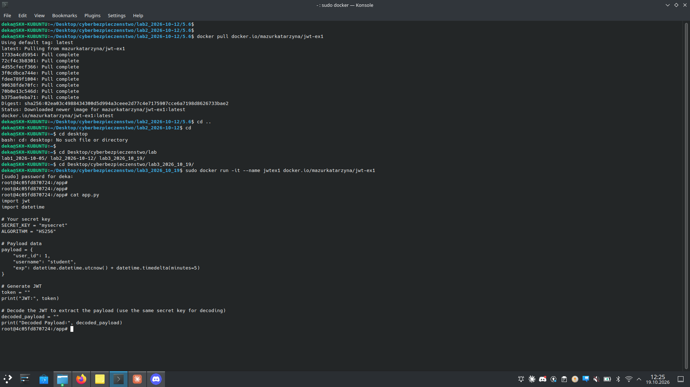
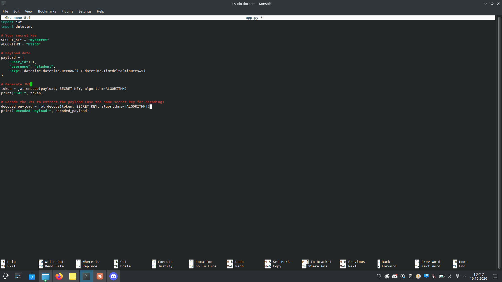
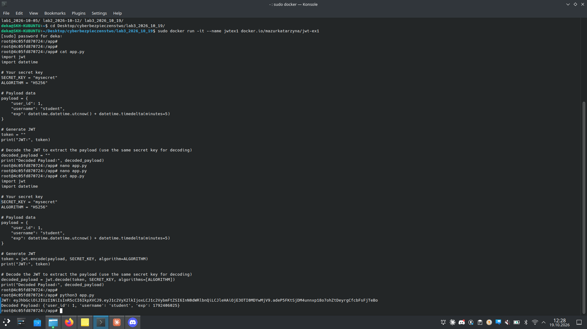
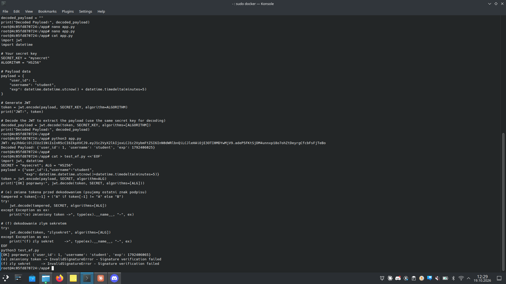

# Zadanie 3.1 — Generowanie JWT i zrozumienie struktury

> **Cel:** uzupełnić szablon `app.py` (biblioteka **PyJWT**) o kodowanie i
> dekodowanie tokena JWT, a następnie zaobserwować zachowanie przy manipulacji
> tokenem **(e)** i przy złym sekrecie **(f)**.

| | |
|---|---|
| **Kontener** | `docker run -it --name jwtex1 docker.io/mazurkatarzyna/jwt-ex1` |
| **Biblioteka** | PyJWT |
| **Algorytm** | HS256 |
| **Sekret** | `mysecret` |

---

## Krok 1 — szablon do uzupełnienia

W kontenerze znajduje się `app.py` z dwoma pustymi miejscami (`token = ""`,
`decoded_payload = ""`).



## Krok 2 — uzupełnienie kodu

```python
# Generate JWT
token = jwt.encode(payload, SECRET_KEY, algorithm=ALGORITHM)
print("JWT:", token)

# Decode the JWT to extract the payload
decoded_payload = jwt.decode(token, SECRET_KEY, algorithms=[ALGORITHM])
print("Decoded Payload:", decoded_payload)
```



## Krok 3 — uruchomienie

```bash
python3 app.py
```



Struktura wygenerowanego tokena (3 części Base64url oddzielone kropkami):

```
eyJhbGciOiJIUzI1NiIsInR5cCI6IkpXVCJ9 . eyJ1c2VyX2lkIjox...In0 . adeP5FKtSjDM4...TeBo
└──────── HEADER ────────┘             └──── PAYLOAD ────┘       └──── SIGNATURE ────┘
 {"alg":"HS256","typ":"JWT"}    {"user_id":1,"username":"student","exp":...}   HMAC-SHA256(h.p, secret)
```

---

## Krok 4 — obserwacje (e) i (f)

Skrypt `test_ef.py` sprawdza dwa scenariusze ataku na integralność:



```
[OK] poprawny: {'user_id': 1, 'username': 'student', 'exp': ...}
(e) zmieniony token -> InvalidSignatureError - Signature verification failed
(f) zly sekret      -> InvalidSignatureError - Signature verification failed
```

| Scenariusz | Co robimy | Wynik |
|-----------|-----------|-------|
| **(e)** | zmiana choćby 1 znaku w tokenie przed dekodowaniem | `InvalidSignatureError` |
| **(f)** | dekodowanie innym (złym) sekretem | `InvalidSignatureError` |

---

## Wnioski

- Payload JWT jest **podpisany, nie szyfrowany** — da się go odczytać (Base64),
  ale **nie da się podmienić** bez znajomości sekretu.
- **(e)** Każda zmiana tokena → przeliczony HMAC ≠ podpis w tokenie → odrzucenie.
- **(f)** Zły sekret → serwer liczy inny HMAC → też odrzucenie.
- Cała gwarancja **integralności i autentyczności** opiera się na tajności sekretu.

## Pliki
- `app.py` — uzupełniony szablon (kodowanie + dekodowanie)
- `test_ef.py` — demonstracja obserwacji (e) i (f)
