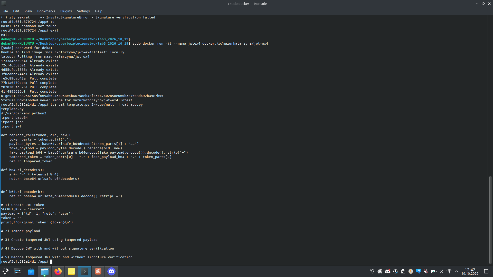
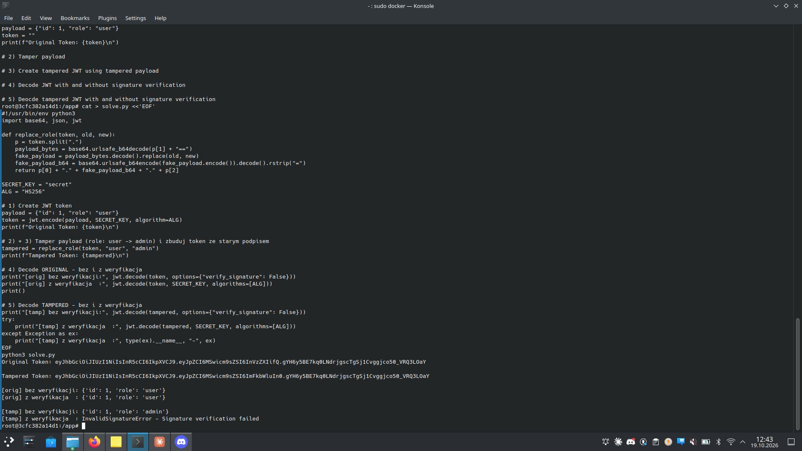

# Zadanie 3.4 — Weryfikacja podpisu JWT

> **Cel:** pokazać różnicę między dekodowaniem JWT **z** weryfikacją podpisu i
> **bez** niej, oraz skutek manipulacji payloadu (podmiana `role: user → admin`).

| | |
|---|---|
| **Kontener** | `docker run -it --name jwtex4 docker.io/mazurkatarzyna/jwt-ex4` |
| **Sekret** | `secret` |
| **Payload** | `{"id": 1, "role": "user"}` |
| **Algorytm** | HS256 |

---

## Krok 1 — szablon

Szablon `template.py` dostarcza funkcję `replace_role()` — podmienia tekst w
payloadzie i składa token z **oryginalnym** (niezmienionym) podpisem.



## Krok 2 — kluczowe wywołania PyJWT

```python
# bez weryfikacji podpisu (czysty odczyt):
jwt.decode(token, options={"verify_signature": False})

# z weryfikacja (sprawdza podpis sekretem):
jwt.decode(token, SECRET_KEY, algorithms=["HS256"])
```

## Krok 3 — uruchomienie i wynik



```
Original Token: ...R5cCI6IkpXVCJ9.eyJpZCI6MSwicm9sZSI6InVzZXIifQ.gYH6y5BE...LOaY
Tampered Token: ...R5cCI6IkpXVCJ9.eyJpZCI6MSwicm9sZSI6ImFkbWluIn0.gYH6y5BE...LOaY
                 ^^^ ten sam HEADER   ^^^ PAYLOAD role=admin         ^^^ ten sam PODPIS

[orig] bez weryfikacji: {'id': 1, 'role': 'user'}
[orig] z weryfikacja  : {'id': 1, 'role': 'user'}

[tamp] bez weryfikacji: {'id': 1, 'role': 'admin'}   <-- podmiana zaakceptowana!
[tamp] z weryfikacja  : InvalidSignatureError - Signature verification failed  <-- odparte
```

---

## Analiza (a–d)

| Pkt | Operacja | Wynik |
|-----|----------|-------|
| **(a)** | utworzenie tokena | `header.payload.signature` (Base64url) |
| **(b)** | decode **z** weryfikacją | payload zwrócony tylko gdy podpis pasuje do sekretu |
| **(c)** | decode **bez** weryfikacji | payload zwrócony bez sprawdzania podpisu |
| **(d) bez** | tampered (`role=admin`), bez weryfikacji | ✗ `admin` **zaakceptowany** — eskalacja uprawnień |
| **(d) z** | tampered (`role=admin`), z weryfikacją | ✓ `InvalidSignatureError` — atak odparty |

W tokenie zmodyfikowanym zmienił się **tylko payload** (`user`→`admin`); header
i podpis pozostały identyczne jak w oryginale. Dlatego przy weryfikacji podpis
nie pasuje do nowego payloadu i token jest odrzucany.

## Morał
Każdy token przychodzący od klienta musi być dekodowany **z weryfikacją
podpisu**. Ustawienie `verify_signature=False` zamienia JWT w zwykły,
niechroniony JSON — każdy może podmienić dowolne pole (np. `role`).

## Pliki
- `solve.py` — kompletny skrypt realizujący (a)–(d)
