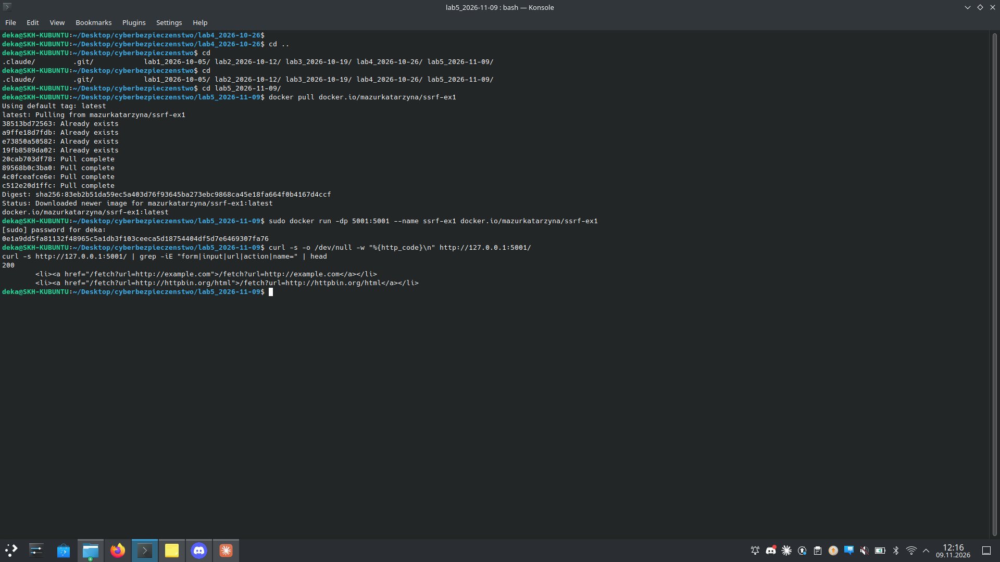
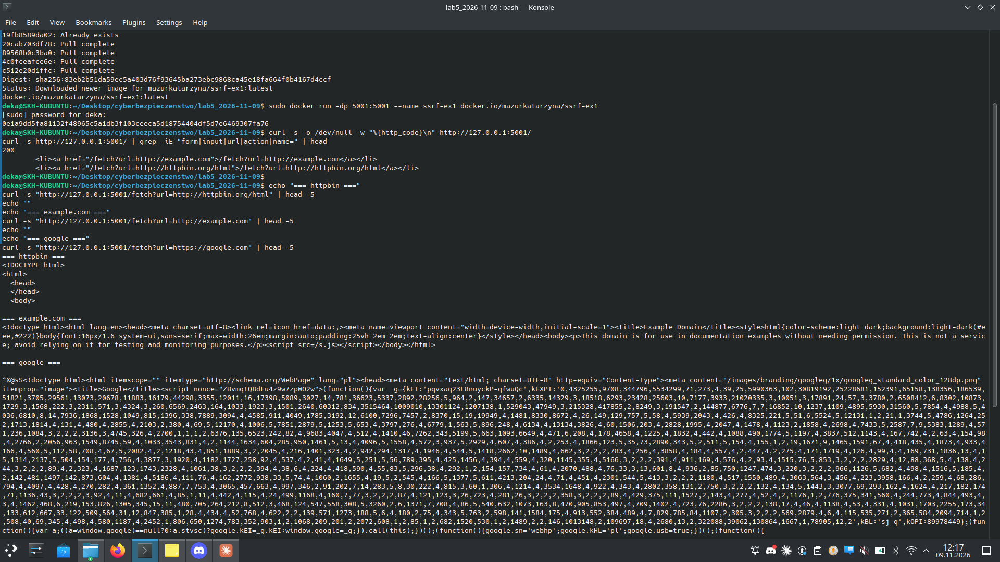
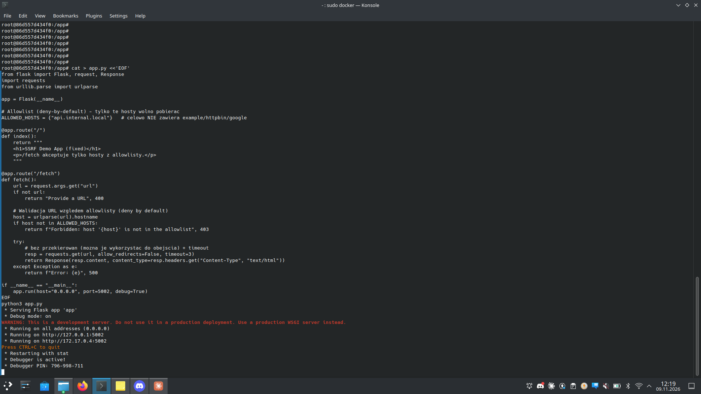
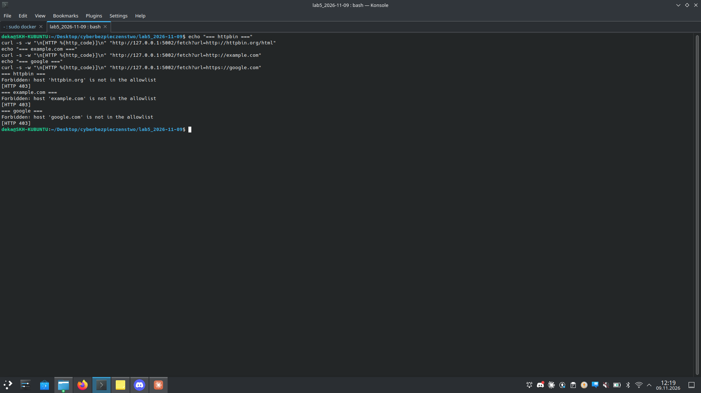

# Zadanie 2.1 — SSRF w prostym serwerze HTTP (CWE-918) + naprawa allowlistą

> **Cel:** pokazać podatność SSRF (serwer pobiera dowolny URL podany przez
> użytkownika), a następnie ją naprawić, wymuszając **allowlistę** dozwolonych
> hostów.

| | |
|---|---|
| **Podatny serwer** | `docker run -dp 5001:5001 --name ssrf-ex1 docker.io/mazurkatarzyna/ssrf-ex1` → `http://127.0.0.1:5001` |
| **Serwer do naprawy** | `docker run -it -p 5002:5002 --name ssrfixex1 docker.io/mazurkatarzyna/ssrf-fix-ex1` → `http://127.0.0.1:5002` |
| **Podatność** | CWE-918 (Server-Side Request Forgery) |
| **Endpoint** | `GET /fetch?url=<URL>` |

## a) + b) Demonstracja SSRF

Endpoint `/fetch?url=` pobiera **dowolny** adres po stronie serwera:



```bash
curl -s "http://127.0.0.1:5001/fetch?url=http://httpbin.org/html"
curl -s "http://127.0.0.1:5001/fetch?url=http://example.com"
curl -s "http://127.0.0.1:5001/fetch?url=https://google.com"
```

Każdy zwraca **HTML zdalnej strony** pobrany przez serwer — to istota SSRF:
aplikacja wykonuje żądania sieciowe w imieniu atakującego, do dowolnego celu
(także adresów wewnętrznych niedostępnych z zewnątrz, np. `127.0.0.1`,
`169.254.169.254` — metadata chmury).



## c) + d) Naprawa — allowlist (deny-by-default)

Podatny kod: `resp = requests.get(url)` bez żadnej walidacji. Poprawka w `app.py`:

```python
from urllib.parse import urlparse

ALLOWED_HOSTS = {"api.internal.local"}   # deny-by-default

@app.route("/fetch")
def fetch():
    url = request.args.get("url")
    if not url:
        return "Provide a URL", 400

    host = urlparse(url).hostname
    if host not in ALLOWED_HOSTS:                       # <-- allowlist
        return f"Forbidden: host '{host}' is not in the allowlist", 403

    resp = requests.get(url, allow_redirects=False, timeout=3)  # bez redirectow + timeout
    return Response(resp.content, content_type=resp.headers.get("Content-Type", "text/html"))
```



Zastosowane zabezpieczenia (zgodnie z hintem — „deny by default", allowlist):
- **Allowlist hostów** — przepuszczamy tylko jawnie dozwolone; wszystko inne 403.
- **`allow_redirects=False`** — redirecty można wykorzystać do obejścia filtra.
- **`timeout=3`** — ogranicza skanowanie/zawieszanie.

## e) + f) Weryfikacja (port 5002)

```bash
curl -s -w "\n[HTTP %{http_code}]\n" "http://127.0.0.1:5002/fetch?url=http://httpbin.org/html"
curl -s -w "\n[HTTP %{http_code}]\n" "http://127.0.0.1:5002/fetch?url=http://example.com"
curl -s -w "\n[HTTP %{http_code}]\n" "http://127.0.0.1:5002/fetch?url=https://google.com"
```

Wynik — wszystkie **403**, URL-e nie są już pobierane:

```
Forbidden: host 'httpbin.org' is not in the allowlist   [HTTP 403]
Forbidden: host 'example.com' is not in the allowlist   [HTTP 403]
Forbidden: host 'google.com'  is not in the allowlist   [HTTP 403]
```



---

## Wnioski
- SSRF = serwer pobiera URL od użytkownika bez walidacji → atakujący kieruje
  żądania na dowolny cel (wewnętrzne usługi, metadata chmury, skanowanie portów).
- Skuteczna obrona to **allowlist** („deny by default"), nie blacklist (blacklisty
  da się obejść przez kodowanie, redirecty, alternatywne zapisy IP itd.).
- Dodatkowo: wyłączyć przekierowania, ustawić timeouty, izolować dostęp sieciowy
  (osobne sieci, firewall), logować połączenia.

## Pliki
- `app_fixed.py` — naprawiona wersja z allowlistą
